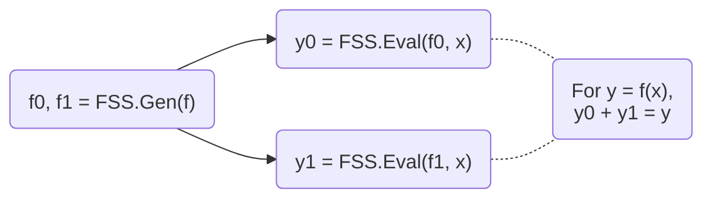

# myl7/fss

Function secret sharing (FSS) primitives including:

- 2-party distributed point function (DPF), based on [Boyle et al. (CCS '16)](https://doi.org/10.1145/2976749.2978429) or [Half-Tree (EUROCRYPT '23)](https://doi.org/10.1007/978-3-031-30545-0_12).
- 2-party distributed comparison function (DCF), based on [Boyle et al. (EUROCRYPT '21)](https://doi.org/10.1007/978-3-030-77886-6_30) or [Grotto (CCS '23)](https://doi.org/10.1145/3576915.3623147).
- 2-party verifiable distributed point function (VDPF), based on [Castro & Polychroniadou (EUROCRYPT '22)](https://doi.org/10.1007/978-3-031-06944-4_6).
- 2-party verifiable distributed multi-point function (VDMPF), based on [Castro & Polychroniadou (EUROCRYPT '22)](https://doi.org/10.1007/978-3-031-06944-4_6).
- 2-party distributed multi-point function (DMPF), the non-verifiable counterpart of VDMPF.

[Documentation](https://myl7.github.io/fss/)

Features:

- First-class support for GPU (based on CUDA)
- CPU and CUDA benchmarks against third-party libraries
- Well-commented and documented
- Header-only library, easy for integration

## Introduction

Multi-party computation (MPC) is a subfield of cryptography that aims to enable a group of parties (e.g., servers) to jointly compute a function over their inputs while keeping the inputs private.

Secret sharing is a method that distributes a secret among a group of parties, such that no individual party holds any information about the secret.
For example, a number $x$ can be secret-shared into $x_0, x_1$ via $x = x_0 + x_1$.

FSS is a scheme to secret-share a function into a group of function shares.
Each function share, called a key, can be individually evaluated by a party.
The outputs of the keys are the shares of the original function output.
FSS consists of 2 methods: `Gen` for generating function shares as keys and `Eval` for evaluating a key to get an output share.
FSS's workflow is shown below:



DPF and DCF are FSS for point/comparison functions.
Two-party DPF and DCF can have $O(\log N)$ key size, where $N$ is the input domain size.
Meanwhile, 3-or-more-party DPF/DCF and general FSS have $O(\sqrt{N})$ key size.
See the API documentation for `Dpf` and `Dcf` for their definitions and input requirements.

## Get started

If you are upgrading from an earlier release, see the [migration guide](doc/migration.md).

### Prerequisites

- CMake >= 3.22
- CUDA toolkit >= 12.0 (for C++20 support). C++ CI is configured for CUDA 12.6 and 13.4.
- OpenMP (optional, for parallel CPU evaluation)
- OpenSSL 3 (optional, for the OpenSSL AES and SHA-256 backends)

### Build

Clone the repository:

```bash
git clone https://github.com/myl7/fss.git
cd fss
```

Install via CMake and use `find_package`:

```bash
cmake -B build -DBUILD_TESTING=OFF -DCMAKE_INSTALL_PREFIX=/path/to/install
cmake --build build
cmake --install build
```

Then in your project's `CMakeLists.txt`:

```cmake
find_package(fss REQUIRED)
target_link_libraries(your_target fss::fss)
```

When configuring your project, point CMake to the install prefix:

```bash
cmake -B build -DCMAKE_PREFIX_PATH=/path/to/install
```

To use the headers without installing, define a target in your `CMakeLists.txt`:

```cmake
add_library(fss INTERFACE)
target_include_directories(fss INTERFACE "/path/to/fss/include")
target_compile_features(fss INTERFACE cxx_std_20 cuda_std_20)
```

Link the target in your project:

```cmake
target_link_libraries(your_target fss)
```

To enable parallel CPU evaluation, follow the [sample CMake configuration](https://github.com/myl7/fss/blob/main/samples/CMakeLists.txt).

### CPU

This example uses DPF and DCF on the CPU with the AES-128 MMO PRG.
This PRG requires OpenSSL.

1. Include the headers and set up type aliases:

   ```cpp
   #include <fss/dpf.cuh>
   #include <fss/dcf.cuh>
   #include <fss/group/bytes.cuh>
   #include <fss/prg/aes128_mmo.cuh>

   constexpr int kInBits = 8;  // Input domain: 2^8 = 256 values
   using In = uint8_t;
   using Group = fss::group::Bytes;

   // DPF uses mul=2, DCF uses mul=4
   using DpfPrg = fss::prg::Aes128Mmo<2>;
   using DcfPrg = fss::prg::Aes128Mmo<4>;
   using Dpf = fss::Dpf<kInBits, Group, DpfPrg, In>;
   using Dcf = fss::Dcf<kInBits, Group, DcfPrg, In>;
   ```

2. Create the PRG with AES keys and instantiate DPF/DCF:

   ```cpp
   // DPF PRG needs 2 AES keys
   unsigned char key0[16] = {1, 2, 3, 4, 5, 6, 7, 8, 9, 10, 11, 12, 13, 14, 15, 16};
   unsigned char key1[16] = {16, 15, 14, 13, 12, 11, 10, 9, 8, 7, 6, 5, 4, 3, 2, 1};
   const unsigned char *keys[2] = {key0, key1};
   auto ctxs = DpfPrg::CreateCtxs(keys);

   DpfPrg prg(ctxs);
   Dpf dpf{prg};
   ```

3. Run `Gen` to generate correction words and control bits from the secret inputs:

   ```cpp
   In alpha = 42;                  // Secret point / threshold
   int4 beta = {7, 0, 0, 0};      // Payload; Gen clears bit 0 of .w.

   // Illustrative seeds only; applications must sample independent uniform seeds.
   int4 seeds[2] = {
       {0x11111111, 0x22222222, 0x33333333, 0x44444440},
       {0x55555555, 0x66666666, 0x77777777, static_cast<int>(0x88888880u)},
   };

   int4 cws[Dpf::kCwCount];
   In tr = 0;
   dpf.Gen(cuda::std::span<int4>(cws, Dpf::kCwCount), tr,
       cuda::std::span<const int4, 2>(seeds, 2), alpha, beta);
   const auto corrections = cuda::std::span<const int4>(cws, Dpf::kCwCount);
   ```

4. Run `Eval` on each party and reconstruct using the group:

   ```cpp
   // Each party evaluates independently with its own key
   int4 y0 = dpf.Eval(false, seeds[0], corrections, tr, alpha);
   int4 y1 = dpf.Eval(true, seeds[1], corrections, tr, alpha);

   // Reconstruct via the group: convert to group elements, add, convert back
   // For Bytes group this is XOR; for Uint group this is arithmetic addition
   int4 sum = (Group::From(y0) + Group::From(y1)).Into();
   // sum == beta at x == alpha, 0 otherwise
   ```

5. Free the AES contexts when done:

   ```cpp
   DpfPrg::FreeCtxs(ctxs);
   ```

DCF follows the same pattern with `DcfPrg` (mul=4, needs 4 AES keys) and `Dcf`.
Allocate both `cws` and `vws` arrays of `Dcf::kCwCount` elements, and pass both spans before `tr` to `Gen` and `Eval`.
Each party receives its own initial seed and the shared corrections.
The reconstructed output equals `beta` when `x < alpha` and `0` otherwise.

Link with OpenSSL in your `CMakeLists.txt`:

```cmake
find_package(OpenSSL REQUIRED)
target_link_libraries(your_target fss::fss OpenSSL::Crypto)
```

If you defined the header-only target above, link `fss` instead of `fss::fss`.
See the [complete CPU example](https://github.com/myl7/fss/blob/main/samples/dpf_dcf_cpu.cu).

### GPU

This example uses DPF and DCF on the GPU with the ChaCha PRG.

1. Include the headers and set up type aliases:

   ```cpp
   #include <fss/dpf.cuh>
   #include <fss/dcf.cuh>
   #include <fss/group/bytes.cuh>
   #include <fss/prg/chacha.cuh>

   constexpr int kInBits = 8;
   using In = uint8_t;
   using Group = fss::group::Bytes;

   // DPF uses mul=2, DCF uses mul=4
   using DpfPrg = fss::prg::ChaCha<2>;
   using DcfPrg = fss::prg::ChaCha<4>;
   using Dpf = fss::Dpf<kInBits, Group, DpfPrg, In>;
   using Dcf = fss::Dcf<kInBits, Group, DcfPrg, In>;
   ```

2. Write a `Gen` kernel.
   Use the same ChaCha nonce for generation and evaluation:

   ```cpp
   struct DeviceKey {
     int4 cws[Dpf::kCwCount];
     In tr;
   };

   __global__ void GenKernel(DeviceKey *keys, const int4 *seeds, const In *alphas,
       const int4 *betas, int n) {
       int tid = blockIdx.x * blockDim.x + threadIdx.x;
       if (tid >= n) return;

       DpfPrg prg(0x12345678, static_cast<int>(0x9abcdef0u));
       Dpf dpf{prg};

       int4 s[2] = {seeds[tid * 2], seeds[tid * 2 + 1]};
       dpf.Gen(cuda::std::span<int4>(keys[tid].cws, Dpf::kCwCount), keys[tid].tr,
           cuda::std::span<const int4, 2>(s, 2), alphas[tid], betas[tid]);
   }
   ```

3. Prepare host data, copy to device, and launch the `Gen` kernel:

   ```cpp
   int4 *d_seeds = /* cudaMalloc + cudaMemcpy seeds to device */;
   In *d_alphas = /* cudaMalloc + cudaMemcpy alphas to device */;
   int4 *d_betas = /* cudaMalloc + cudaMemcpy betas to device */;

   DeviceKey *d_keys;
   cudaMalloc(&d_keys, sizeof(DeviceKey) * N);

   GenKernel<<<blocks, kThreadsPerBlock>>>(d_keys, d_seeds, d_alphas, d_betas, N);
   ```

4. Write and launch an `Eval` kernel for each party, then copy results back:

   ```cpp
   __global__ void EvalKernel(int4 *ys, bool party, const DeviceKey *keys,
       const int4 *seeds, const In *xs, int n) {
       int tid = blockIdx.x * blockDim.x + threadIdx.x;
       if (tid >= n) return;

       DpfPrg prg(0x12345678, static_cast<int>(0x9abcdef0u));
       Dpf dpf{prg};

       ys[tid] = dpf.Eval(party, seeds[tid * 2 + static_cast<int>(party)],
           cuda::std::span<const int4>(keys[tid].cws, Dpf::kCwCount), keys[tid].tr, xs[tid]);
   }

   // Launch for party 0 and party 1, then copy d_ys back to host
   EvalKernel<<<blocks, kThreadsPerBlock>>>(d_y0s, false, d_keys, d_seeds, d_xs, N);
   EvalKernel<<<blocks, kThreadsPerBlock>>>(d_y1s, true, d_keys, d_seeds, d_xs, N);
   ```

5. Reconstruct on the host using the group, same as the CPU case:

   ```cpp
   int4 sum = (Group::From(h_y0s[i]) + Group::From(h_y1s[i])).Into();
   ```

DCF follows the same pattern with `DcfPrg` (mul=4) and `Dcf`, adding a `vws` array to the device storage.
Check every CUDA API return value, kernel launch, and execution result before using the outputs.
Keep device buffers alive until queued work completes, and free them afterwards.
ChaCha and software AES support host and device execution.
OpenSSL and AES-NI backends are host-only.

See the [complete CUDA example](https://github.com/myl7/fss/blob/main/samples/dpf_dcf_gpu.cu).

### Samples

`samples/` holds a standalone program per scheme.
They form their own CMake project:

```bash
cmake -B build/samples -S samples
cmake --build build/samples
```

| Sample                 | Scheme        | Shows                                                                |
| ---------------------- | ------------- | -------------------------------------------------------------------- |
| `dpf_dcf_cpu.cu`       | DPF, DCF      | Host `Gen`/`Eval` with AES-128 MMO PRG                               |
| `dpf_dcf_gpu.cu`       | DPF, DCF      | `Gen`/`Eval` inside CUDA kernels with ChaCha PRG                     |
| `half_tree_dpf_cpu.cu` | Half-Tree DPF | `Gen`/`Eval`/`EvalAll` with a CCR hash and an explicit instance seed      |
| `packed_half_tree_dpf_cpu.cu` | Packed Half-Tree DPF (experimental) | Sub-128-bit packed outputs: `Gen`/`Eval`/`EvalAll`/`Extract` over packed blocks |
| `grotto_dcf_cpu.cu`    | Grotto DCF    | `Gen`/`Preprocess`/`Eval` over a parity segment tree, plus `EvalAll` |
| `vdpf_cpu.cu`          | VDPF          | `Gen`/`Eval`/`EvalAll` plus the `Prove`/`Verify` check               |
| `vdmpf_cpu.cu`         | VDMPF         | `Gen`/`BatchEval` over cuckoo-hash packed points                     |
| `dmpf_cpu.cu`          | DMPF          | `Gen`/`BatchEval` over cuckoo-hash packed points, without verification |

The samples project requires OpenSSL.
`EvalAll` uses OpenMP when available.

### Python

Use Python 3.10 or newer and a CUDA-enabled PyTorch 2.6 or newer.
Choose a PyTorch build whose CUDA major version matches your local CUDA toolkit, even for CPU execution.
Then install the package from this checkout:

```bash
pip install .
```

```python
import secrets
import torch
from fss_crypto import Dpf, group, prg

dpf = Dpf(8, group.Bytes(), prg.ChaCha(nonce=(1, 2), mul=2))
words = [secrets.randbits(32) - 2**31 for _ in range(8)]
s0s = torch.tensor(words, dtype=torch.int32).reshape(2, 4)
b_buf = torch.tensor([7, 0, 0, 0], dtype=torch.int32)
cws = torch.empty(dpf.cws_shape, dtype=torch.uint8)
dpf.gen(cws, s0s, a=42, b_buf=b_buf)
y0 = dpf.eval(b=False, s0=s0s[0], cws=cws, x=42)
y1 = dpf.eval(b=True, s0=s0s[1], cws=cws, x=42)
assert torch.equal(torch.bitwise_xor(y0, y1), b_buf)
```

The [Python samples](https://github.com/myl7/fss/tree/main/samples/python) show CUDA execution and the other schemes.

## Benchmarks

### Comparison curves

FSS curves show v2.0.0 (unreleased).
CPU runs use an AMD EPYC 9115, and GPU runs use an NVIDIA RTX A6000 with CUDA 12.6.
The comparison lists the library versions and configurations for the third-party curves.


CPU `Gen` and point `Eval` report time per key and per query.
`EvalAll` produces the full domain for one key.
VDPF evaluation includes proof generation, with verification outside timing.


GPU point timings divide the measured batch time by its key or query count.
Full-domain curves report time per key after batch normalization.
These throughput measurements are not single-key launch latencies.

The [interactive comparison](https://myl7.github.io/fss/bench/) has exact values and selectable methods.
See the [measurement methodology](doc/bench_figures.md) for output types, proof protocols, timing boundaries, and supplementary figures.

### Run benchmarks

Build and run a selection with [Google Benchmark](https://github.com/google/benchmark):

```bash
cmake -B build -DBUILD_BENCH=ON -DBUILD_TESTING=OFF -DCMAKE_BUILD_TYPE=Release
cmake --build build --target bench_cpu bench_gpu
./build/bench_cpu --benchmark_filter=BM_DcfGen
./build/bench_gpu --benchmark_filter=BM_DpfEvalPointGpu
```

Choose an idle GPU with `CUDA_VISIBLE_DEVICES` before running CUDA benchmarks.
For pinned CPU runs, sampling profiles, full-domain workloads, and third-party adapters, see the [benchmark runner guide](doc/bench_third_parties.md).

### Flamegraph

Generate a CPU flamegraph with `perf` and [FlameGraph](https://github.com/brendangregg/FlameGraph):

```bash
cmake -B build -DBUILD_BENCH=ON -DBUILD_TESTING=OFF -DCMAKE_BUILD_TYPE=RelWithDebInfo
cmake --build build --target bench_cpu
perf record -g -o build/perf.data ./build/bench_cpu --benchmark_filter=BM_DpfEval_Uint_Aes/20
perf script -i build/perf.data | /path/to/FlameGraph/stackcollapse-perf.pl | /path/to/FlameGraph/flamegraph.pl > build/flamegraph.svg
```

`make flamegraph` configures a RelWithDebInfo build and runs the profiling commands.
Set `FLAMEGRAPH_DIR` to the FlameGraph checkout and `FLAMEGRAPH_BENCH` to the benchmark filter:

```bash
FLAMEGRAPH_DIR=/path/to/FlameGraph FLAMEGRAPH_BENCH=BM_DcfGen_Uint_Aes/20 make flamegraph
```

Open `build/flamegraph.svg` in a browser.
The graph is interactive: click a frame to zoom in.

## License

Apache License, Version 2.0

Copyright (C) 2026 Yulong Ming <i@myl7.org>
