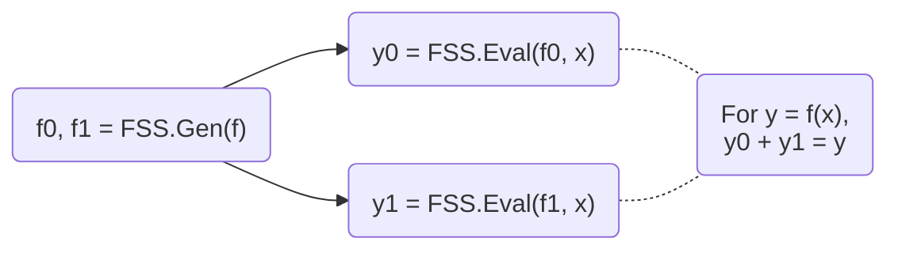
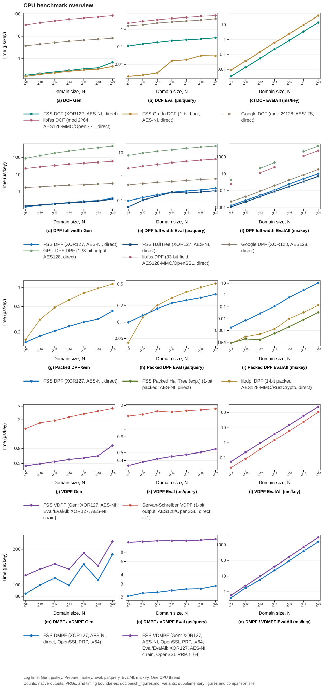
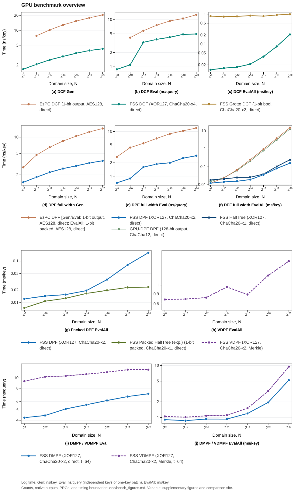

# myl7/fss

Function secret sharing (FSS) primitives including:

- 2-party distributed point function (DPF), based on [Boyle et al. (CCS '16)](https://doi.org/10.1145/2976749.2978429) or [Half-Tree (EUROCRYPT '23)](https://doi.org/10.1007/978-3-031-30545-0_12).
- 2-party distributed comparison function (DCF), based on [Boyle et al. (EUROCRYPT '21)](https://doi.org/10.1007/978-3-030-77886-6_30) or [Grotto (CCS '23)](https://doi.org/10.1145/3576915.3623147).
- 2-party verifiable distributed point function (VDPF), based on [Castro & Polychroniadou (EUROCRYPT '22)](https://doi.org/10.1007/978-3-031-06944-4_6).
- 2-party verifiable distributed multi-point function (VDMPF), based on [Castro & Polychroniadou (EUROCRYPT '22)](https://doi.org/10.1007/978-3-031-06944-4_6).
- 2-party distributed multi-point function (DMPF), the non-verifiable counterpart of VDMPF.

[Documentation](https://myl7.github.io/fss/)

Features:

- First-class support for GPU (based on CUDA)
- CPU and CUDA benchmarks against third-party libraries
- Well-commented and documented
- Header-only library, easy for integration

## Introduction

**Multi-party computation (MPC)** is a subfield of cryptography that aims to enable a group of parties (e.g., servers) to jointly compute a function over their inputs while keeping the inputs private.

**Secret sharing** is a method that distributes a secret among a group of parties, such that no individual party holds any information about the secret.
For example, a number $x$ can be secret-shared into $x_0, x_1$ via $x = x_0 + x_1$.

**FSS** is a scheme to secret-share a function into a group of function shares.
Each function share, called a **key**, can be individually evaluated by a party.
The outputs of the keys are the shares of the original function output.
FSS consists of 2 methods: `Gen` for generating function shares as keys and `Eval` for evaluating a key to get an output share.
FSS's workflow is shown below:



**DPF/DCF** are FSS for point/comparison functions.
They are called out because 2-party DPF/DCF can have $O(\log N)$ key size, where $N$ is the input domain size.
Meanwhile, 3-or-more-party DPF/DCF and general FSS have $O(\sqrt{N})$ key size.
More details, including the definitions and the implementation details that users must care about, can be found in the documentation of dpf.cuh and dcf.cuh files.
For changes from earlier releases, see the [migration guide](doc/migration.md).

## Get Started

### Prerequisites

- CMake >= 3.22
- CUDA toolkit >= 12.0 (for C++20 support). C++ CI is configured for CUDA 12.6 and 13.4.
- OpenMP headers; automatic and parallel CPU evaluation also require OpenMP compiler flags and runtime linkage.
- OpenSSL 3 for OpenSSL AES PRGs/PRPs and SHA256 on CPU

### Build

Clone the repository:

```bash
git clone https://github.com/myl7/fss.git
cd fss
```

**Option A: Install via CMake and use `find_package`**

```bash
cmake -B build -DBUILD_TESTING=OFF -DCMAKE_INSTALL_PREFIX=/path/to/install
cmake --build build
cmake --install build
```

Then in your project's `CMakeLists.txt`:

```cmake
find_package(fss REQUIRED)
target_link_libraries(your_target fss::fss)
```

When configuring your project, point CMake to the install prefix:

```bash
cmake -B build -DCMAKE_PREFIX_PATH=/path/to/install
```

**Option B: Use as a subdirectory (header-only)**

Without installing, you can define the target directly in your `CMakeLists.txt`, like the samples do:

```cmake
add_library(fss INTERFACE)
target_include_directories(fss INTERFACE "/path/to/fss/include")
target_compile_features(fss INTERFACE cxx_std_20 cuda_std_20)
```

Then link it in your project:

```cmake
target_link_libraries(your_target fss)
```

### CPU

This walks through using DPF and DCF on the CPU with AES-128 MMO PRG.
This PRG requires OpenSSL.

1. Include the headers and set up type aliases:

   ```cpp
   #include <fss/dpf.cuh>
   #include <fss/dcf.cuh>
   #include <fss/group/bytes.cuh>
   #include <fss/prg/aes128_mmo.cuh>

   constexpr int kInBits = 8;  // Input domain: 2^8 = 256 values
   using In = uint8_t;
   using Group = fss::group::Bytes;

   // DPF uses mul=2, DCF uses mul=4
   using DpfPrg = fss::prg::Aes128Mmo<2>;
   using DcfPrg = fss::prg::Aes128Mmo<4>;
   using Dpf = fss::Dpf<kInBits, Group, DpfPrg, In>;
   using Dcf = fss::Dcf<kInBits, Group, DcfPrg, In>;
   ```

2. Create the PRG with AES keys and instantiate DPF/DCF:

   ```cpp
   // DPF PRG needs 2 AES keys
   unsigned char key0[16] = {1, 2, 3, 4, 5, 6, 7, 8, 9, 10, 11, 12, 13, 14, 15, 16};
   unsigned char key1[16] = {16, 15, 14, 13, 12, 11, 10, 9, 8, 7, 6, 5, 4, 3, 2, 1};
   const unsigned char *keys[2] = {key0, key1};
   auto ctxs = DpfPrg::CreateCtxs(keys);

   DpfPrg prg(ctxs);
   Dpf dpf{prg};
   ```

3. Run `Gen` to generate correction words (keys) from secret inputs:

   ```cpp
   In alpha = 42;                  // Secret point / threshold
   int4 beta = {7, 0, 0, 0};      // Secret payload (LSB of .w must be 0)

   // Illustrative seeds only; applications must sample independent uniform seeds.
   int4 seeds[2] = {
       {0x11111111, 0x22222222, 0x33333333, 0x44444440},
       {0x55555555, 0x66666666, 0x77777777, static_cast<int>(0x88888880u)},
   };

   int4 cws[Dpf::kCwCount];
   In tr = 0;
   dpf.Gen(cuda::std::span<int4>(cws, Dpf::kCwCount), tr,
       cuda::std::span<const int4, 2>(seeds, 2), alpha, beta);
   const auto corrections = cuda::std::span<const int4>(cws, Dpf::kCwCount);
   ```

4. Run `Eval` on each party and reconstruct using the group:

   ```cpp
   // Each party evaluates independently with its own key
   int4 y0 = dpf.Eval(false, seeds[0], corrections, tr, alpha);
   int4 y1 = dpf.Eval(true, seeds[1], corrections, tr, alpha);

   // Reconstruct via the group: convert to group elements, add, convert back
   // For Bytes group this is XOR; for Uint group this is arithmetic addition
   int4 sum = (Group::From(y0) + Group::From(y1)).Into();
   // sum == beta at x == alpha, 0 otherwise
   ```

5. Free the AES contexts when done:

   ```cpp
   DpfPrg::FreeCtxs(ctxs);
   ```

DCF follows the same pattern with `DcfPrg` (mul=4, needs 4 AES keys) and `Dcf`.
Allocate both `cws` and `vws` arrays of `Dcf::kCwCount` elements, and pass both spans before `tr` to `Gen` and `Eval`.
Each party receives its own initial seed and the shared corrections.
The reconstructed output equals `beta` when `x < alpha` and `0` otherwise.
VDPF, DMPF, and VDMPF generation can request a retry.
Their `Gen` documentation specifies which caller-owned seeds to resample.
Callers choose the randomness source, retry limit, and failure handling.

Link with OpenSSL in your `CMakeLists.txt`:

```cmake
find_package(OpenSSL REQUIRED)
target_link_libraries(your_target fss OpenSSL::Crypto)
```

See `samples/dpf_dcf_cpu.cu` for the complete working example.

### CPU Point Evaluation Fast Path

DPF and Half-Tree DPF now evaluate the split correction words and packed control bits directly through `Eval`.
The former `point_eval_cpu.cuh` header and separate packed point-key helpers have been removed.
Use the current `Gen` and `Eval` interfaces shown above and in the [samples](samples/).
See the [migration guide](doc/migration.md) when updating callers of the old helpers.

### GPU

This walks through using DPF and DCF on the GPU with ChaCha PRG.

1. Include the headers and set up type aliases:

   ```cpp
   #include <fss/dpf.cuh>
   #include <fss/dcf.cuh>
   #include <fss/group/bytes.cuh>
   #include <fss/prg/chacha.cuh>

   constexpr int kInBits = 8;
   using In = uint8_t;
   using Group = fss::group::Bytes;

   // DPF uses mul=2, DCF uses mul=4
   using DpfPrg = fss::prg::ChaCha<2>;
   using DcfPrg = fss::prg::ChaCha<4>;
   using Dpf = fss::Dpf<kInBits, Group, DpfPrg, In>;
   using Dcf = fss::Dcf<kInBits, Group, DcfPrg, In>;
   ```

2. Write a `Gen` kernel; the PRG stores its nonce by value, so one PRG instance works on host and device:

   ```cpp
   struct DeviceKey {
     int4 cws[Dpf::kCwCount];
     In tr;
   };

   __global__ void GenKernel(DeviceKey *keys, const int4 *seeds, const In *alphas,
       const int4 *betas, int n) {
       int tid = blockIdx.x * blockDim.x + threadIdx.x;
       if (tid >= n) return;

       DpfPrg prg(0x12345678, static_cast<int>(0x9abcdef0u));
       Dpf dpf{prg};

       int4 s[2] = {seeds[tid * 2], seeds[tid * 2 + 1]};
       dpf.Gen(cuda::std::span<int4>(keys[tid].cws, Dpf::kCwCount), keys[tid].tr,
           cuda::std::span<const int4, 2>(s, 2), alphas[tid], betas[tid]);
   }
   ```

3. Prepare host data, copy to device, and launch the `Gen` kernel:

   ```cpp
   int4 *d_seeds = /* cudaMalloc + cudaMemcpy seeds to device */;
   In *d_alphas = /* cudaMalloc + cudaMemcpy alphas to device */;
   int4 *d_betas = /* cudaMalloc + cudaMemcpy betas to device */;

   DeviceKey *d_keys;
   cudaMalloc(&d_keys, sizeof(DeviceKey) * N);

   GenKernel<<<blocks, kThreadsPerBlock>>>(d_keys, d_seeds, d_alphas, d_betas, N);
   ```

4. Write and launch an `Eval` kernel for each party, then copy results back:

   ```cpp
   __global__ void EvalKernel(int4 *ys, bool party, const DeviceKey *keys,
       const int4 *seeds, const In *xs, int n) {
       int tid = blockIdx.x * blockDim.x + threadIdx.x;
       if (tid >= n) return;

       DpfPrg prg(0x12345678, static_cast<int>(0x9abcdef0u));
       Dpf dpf{prg};

       ys[tid] = dpf.Eval(party, seeds[tid * 2 + static_cast<int>(party)],
           cuda::std::span<const int4>(keys[tid].cws, Dpf::kCwCount), keys[tid].tr, xs[tid]);
   }

   // Launch for party 0 and party 1, then copy d_ys back to host
   EvalKernel<<<blocks, kThreadsPerBlock>>>(d_y0s, false, d_keys, d_seeds, d_xs, N);
   EvalKernel<<<blocks, kThreadsPerBlock>>>(d_y1s, true, d_keys, d_seeds, d_xs, N);
   ```

5. Reconstruct on the host using the group, same as the CPU case:

   ```cpp
   int4 sum = (Group::From(h_y0s[i]) + Group::From(h_y1s[i])).Into();
   ```

DCF follows the same pattern with `DcfPrg` (mul=4) and `Dcf`, adding a `vws` array to the device storage.
Check every CUDA API return value, kernel launch, and execution result before using the outputs.
Keep device buffers alive until queued work completes, and free them afterwards.
ChaCha and software AES support host and device execution.
OpenSSL and AES-NI backends are host-only.
See [CUDA usage notes](doc/cuda_usage.md) for compiler limitations.

See `samples/dpf_dcf_gpu.cu` for the complete working example.

### Samples

`samples/` holds a standalone program per scheme.
They form their own CMake project:

```bash
cmake -B build/samples -S samples
cmake --build build/samples
```

| Sample                 | Scheme        | Shows                                                                |
| ---------------------- | ------------- | -------------------------------------------------------------------- |
| `dpf_dcf_cpu.cu`       | DPF, DCF      | Host `Gen`/`Eval` with AES-128 MMO PRG                               |
| `dpf_dcf_gpu.cu`       | DPF, DCF      | `Gen`/`Eval` inside CUDA kernels with ChaCha PRG                     |
| `half_tree_dpf_cpu.cu` | Half-Tree DPF | `Gen`/`Eval`/`EvalAll` with a mul=1 PRG and a separate hash key      |
| `packed_half_tree_dpf_cpu.cu` | Packed Half-Tree DPF (experimental) | Sub-128-bit packed outputs: `Gen`/`Eval`/`EvalAll`/`Extract` over packed blocks |
| `grotto_dcf_cpu.cu`    | Grotto DCF    | `Gen`/`Preprocess`/`Eval` over a parity segment tree, plus `EvalAll` |
| `vdpf_cpu.cu`          | VDPF          | `Gen`/`Eval`/`EvalAll` plus the `Prove`/`Verify` check               |
| `vdmpf_cpu.cu`         | VDMPF         | `Gen`/`BatchEval` over cuckoo-hash packed points                     |
| `dmpf_cpu.cu`          | DMPF          | `Gen`/`BatchEval` over cuckoo-hash packed points, without verification |

The CPU samples link OpenSSL, and `EvalAll` uses OpenMP when it is found.

### Python

The `fss_crypto` package exposes PyTorch wrappers for the schemes and is published on PyPI as `fss-crypto`.
Install it with pip or add it to a uv project:

```bash
pip install fss-crypto
uv add fss-crypto
```

`fss_crypto` uses PyTorch tensors for seeds, corrections, outputs, and proofs.
It requires Python 3.10 or newer and PyTorch 2.6 or newer.
Its JIT compiler requires a CUDA toolkit compatible with the installed PyTorch CUDA major version, including for CPU operations.

Install the checkout and development dependencies:

```bash
uv sync --extra dev
```

```python
import secrets
import torch
from fss_crypto import Dpf, group, prg

dpf = Dpf(8, group.Bytes(), prg.ChaCha(nonce=(1, 2), mul=2))
words = [secrets.randbits(32) - 2**31 for _ in range(8)]
s0s = torch.tensor(words, dtype=torch.int32).reshape(2, 4)
b_buf = torch.tensor([7, 0, 0, 0], dtype=torch.int32)
cws = torch.empty(dpf.cws_shape, dtype=torch.uint8)
dpf.gen(cws, s0s, a=42, b_buf=b_buf)
y0 = dpf.eval(b=False, s0=s0s[0], cws=cws, x=42)
y1 = dpf.eval(b=True, s0=s0s[1], cws=cws, x=42)
assert torch.equal(torch.bitwise_xor(y0, y1), b_buf)
```

Use contiguous tensors on the same device for each operation.
For CUDA execution, allocate or transfer all tensors to the selected CUDA device first.

The [Python guide](doc/python.md) covers buffer layouts, retries, CUDA streams, JIT compilation, and reusable compilation caches.
Runnable [Python samples](samples/python/) cover point, comparison, verifiable, and multipoint functions.

### nvcc: 128-bit moduli in kernel template arguments

Some nvcc versions emit a bare 128-bit integer literal in a host launch stub when a kernel template argument contains `Uint<__uint128_t, mod>` with a wide modulus.
The host compiler cannot parse that literal correctly, even though the original expression and the group's `static_assert` are valid.
Use `fss::group::Uint128` from `<fss/group/uint128.cuh>` instead.
Its modulus is a `Uint128Modulus{low, high}` structural template argument, so generated stubs can spell it as two 64-bit values.
The default modulus is 2^127.
See the [migration guide](doc/migration.md) for the replacement syntax.

## Benchmarks

See [benchmark methodology and comparison curves](doc/bench_figures.md) for the current full-output adapters and domain sweeps.
The binaries below are built on [Google Benchmark](https://github.com/google/benchmark) and report operation or batch times as documented for each case.
The [benchmark coverage](doc/benchmarks.md) page lists what they measure and the GPU kernel register usage.

Configure with `BUILD_BENCH=ON` and build the targets:

```bash
cmake -B build -DBUILD_BENCH=ON -DCMAKE_BUILD_TYPE=RelWithDebInfo
cmake --build build --target bench_cpu bench_gpu
```

Run all benchmarks:

```bash
./build/bench_cpu
./build/bench_gpu
```

Run a subset using `--benchmark_filter` (regex):

```bash
./build/bench_cpu --benchmark_filter=BM_DcfGen
./build/bench_cpu --benchmark_filter=BM_DpfEval_Uint_Aes/20
```

The `Makefile` runs these sources through `third_party/bench.py`.
Both CPU and GPU runs pin the host process to `CPU_ID`, verify the performance governor, and restore its previous value on exit.
A governor change may require noninteractive `sudo`.
`make bench_gpu` also selects `GPU_ID`.
Builds, raw measurements, environment metadata, and reports are saved under `build/third_party/`.

```bash
CPU_ID=0 make bench_cpu
GPU_ID=1 CUDA_ARCH=86 make bench_gpu
```

The [third-party comparison guide](doc/bench_third_parties.md) covers fixed dependency versions, selecting libraries, and generating reports.
The `main` selection runs the benchmarks in this README:

```bash
python3 third_party/bench.py run --libraries main --platform cpu --cpu 24 \
  --profile decision --run-id readme-cpu
python3 third_party/bench.py run --libraries main --platform gpu --cpu 8 --gpu 1 \
  --cuda-arch 120 --profile decision --run-id readme-gpu
```

Choose idle, allowed CPU and GPU indices on your host.
Direct binary invocations above leave affinity and the governor to the caller.

`CUDA_ARCH` is only needed when CMake cannot infer the architecture.
Two more targets support the sections below: `make ptx_info` rebuilds with `--ptxas-options=-v` and collects the register usage into `build/ptx_info.log`, and `make profile_gpu` records an Nsight Systems profile of one benchmark selected by `GPU_PROFILE_BENCH`.

Measured with the `decision` profile and five interleaved repetitions (0.3 s minimum, medians) on 2026-11-08 UTC (2026-11-09 HKT) at the unreleased tree after v1.3.0, over the 2^20 domain:

- CPU, cs659b (one core, `performance` governor, OpenSSL AES PRG, `Uint` group): DPF `Gen` 1.0 µs/key, point `Eval` 344 ns/query, `EvalAll` 27.7 ms per full-domain evaluation (about 37.9 M outputs/s); DCF `Gen` 1.8 µs/key, point `Eval` 519 ns/query, `EvalAll` 54.3 ms per evaluation (about 19.3 M outputs/s).
- GPU, cs11369a (A6000, SM 86, CUDA event time): in the native suite (`Uint` group, ChaCha PRG, 1,048,576 keys or queries per call), DPF point `Gen` is about 3.6 ns/key and point `Eval` about 2.6 ns/query, and one 1024-key batch full-domain `EvalAll` API call takes 136 ms (DPF) and 142 ms (DCF), about 7.9 and 7.5 G domain outputs/s per call, which is batch time and not single-key latency. The domain curves measure the byte group at 262,144 keys per call; their per-call values differ and are on the comparison site.

These are single-collection medians on shared hosts, not a strict comparison against historical settings.
The [comparison site](https://myl7.github.io/fss/bench/) carries the full domain sweeps, the third-party baselines with their original dates, and the exact per-run sampling.

### Comparison Curves

The domain sweep measures domain sizes `N = 2^8, 2^10, ..., 2^20`.
Each figure shows one platform, with five rows: DCF, full-width DPF, packed DPF, VDPF, and DMPF/VDMPF. Columns show `Gen`, `Eval`, and `EvalAll`.
Logarithmic time axes retain the full measured range. Legends distinguish the construction, output shape, PRG, and proof accumulator; colors, markers, and line styles identify each method.
Separate figures cover [prepared-key costs](doc/figures/cpu-prepared.svg), [proof accumulators](doc/figures/cpu-proof.svg), [PRP backends](doc/figures/cpu-prp.svg), and [GPU output groups](doc/figures/gpu-output-groups.svg). The comparison site supports selecting individual methods to inspect overlapping curves.
Hardware, sampling, timing boundaries, and reproduction commands are in the [curve methodology](doc/bench_figures.md).
The exact measured medians behind the curves, with per-domain values and pairwise library comparison, are on the [benchmark comparison site](https://myl7.github.io/fss/bench/).
An implementation appears in a panel only where it provides that method on that platform.
Gen timings count one call producing both party keys.



CPU point evaluation uses one key and one thread, in µs/query; generation uses µs/key.
`EvalAll` produces all N outputs for one key, in ms/key.
The slow materialized point-loop cases use five domain sizes.
The verifiable VDPF curves (FSS VDPF and the Servan-Schreiber reference, eprint 2021/580, single point) include proof generation in the timed evaluation.
Verification stays outside timing.
Grotto DCF point `Eval` times the parity-tree query with Preprocess outside timing.
DMPF and VDMPF use `t = 64` points over `m = 112` Cuckoo buckets.
The VDMPF `EvalAll` benchmark materializes all inputs through batch evaluation, including proof generation.



GPU `Gen` reports ns/key. Point `Eval` reports ns/query: ordinary point kernels use independent keys, while DMPF/VDMPF evaluate many queries against one key.
`EvalAll` curves report time per key after normalizing the measured batch.
The current FSS domain curves use 262,144 keys per call with byte outputs.
See the methodology for batch sizes and timing boundaries of each adapter.
The native GPU-DPF and packed EzPC adapters keep their native output configurations.
GPU `EvalAll` covers DPF, HalfTree DPF, DCF, the one-bit packed HalfTree DPF, VDPF and VDMPF with Merkle-fold proofs computed on device, Grotto DCF, and DMPF.
The threads-per-block sweep lives in the [curve methodology](doc/bench_figures.md).

### Flamegraph

Generate a CPU flamegraph with `perf` and [FlameGraph](https://github.com/brendangregg/FlameGraph):

```bash
perf record -g ./build/bench_cpu --benchmark_filter=BM_DpfEval_Uint_Aes/20
perf script | /path/to/FlameGraph/stackcollapse-perf.pl | /path/to/FlameGraph/flamegraph.pl > build/flamegraph.svg
```

`make flamegraph` runs the same steps, taking the FlameGraph checkout from `FLAMEGRAPH_DIR` (default `../FlameGraph`) and the benchmark from `FLAMEGRAPH_BENCH`:

```bash
FLAMEGRAPH_DIR=/path/to/FlameGraph FLAMEGRAPH_BENCH=BM_DcfGen_Uint_Aes/20 make flamegraph
```

Open `build/flamegraph.svg` in a browser.
The graph is interactive: click a frame to zoom in.

## License

Apache License, Version 2.0

Copyright (C) 2026 Yulong Ming <i@myl7.org>
