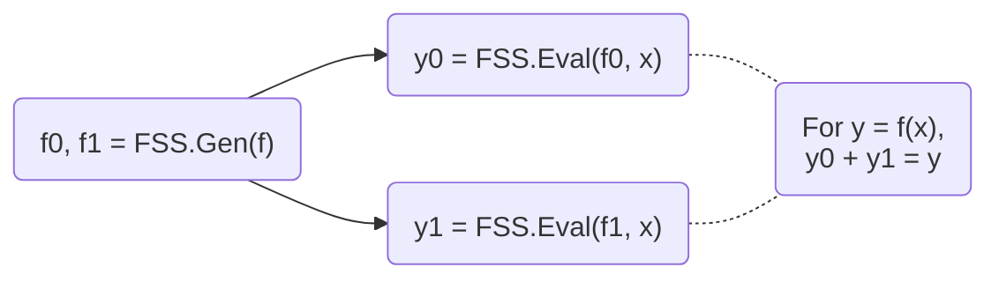

# myl7/fss

Function secret sharing (FSS) primitives including:

- 2-party distributed point function (DPF), based on [Boyle et al. (CCS '16)](https://doi.org/10.1145/2976749.2978429) or [Half-Tree (EUROCRYPT '23)](https://doi.org/10.1007/978-3-031-30545-0_12).
- 2-party distributed comparison function (DCF), based on [Boyle et al. (EUROCRYPT '21)](https://doi.org/10.1007/978-3-030-77886-6_30) or [Grotto (CCS '23)](https://doi.org/10.1145/3576915.3623147) over a Boyle et al. or packed Half-Tree DPF key.
- 2-party verifiable distributed point function (VDPF), based on [Castro & Polychroniadou (EUROCRYPT '22)](https://doi.org/10.1007/978-3-031-06944-4_6).
- 2-party verifiable distributed multi-point function (VDMPF), based on [Castro & Polychroniadou (EUROCRYPT '22)](https://doi.org/10.1007/978-3-031-06944-4_6).
- 2-party distributed multi-point function (DMPF), the non-verifiable counterpart of VDMPF.

[Documentation](https://myl7.github.io/fss/)

Features:

- First-class support for GPU (based on CUDA)
- CPU and CUDA benchmarks against third-party libraries
- Well-commented and documented
- Header-only library, easy for integration

## Introduction

**Multi-party computation (MPC)** is a subfield of cryptography that aims to enable a group of parties (e.g., servers) to jointly compute a function over their inputs while keeping the inputs private.

**Secret sharing** is a method that distributes a secret among a group of parties, such that no individual party holds any information about the secret.
For example, a number $x$ can be secret-shared into $x_0, x_1$ via $x = x_0 + x_1$.

**FSS** is a scheme to secret-share a function into a group of function shares.
Each function share, called a **key**, can be individually evaluated by a party.
The outputs of the keys are the shares of the original function output.
FSS consists of 2 methods: `Gen` for generating function shares as keys and `Eval` for evaluating a key to get an output share.
FSS's workflow is shown below:



**DPF/DCF** are FSS for point/comparison functions.
They are called out because 2-party DPF/DCF can have $O(\log N)$ key size, where $N$ is the input domain size.
Meanwhile, 3-or-more-party DPF/DCF and general FSS have $O(\sqrt{N})$ key size.
More details, including the definitions and the implementation details that users must care about, can be found in the documentation of dpf.cuh and dcf.cuh files.

## Get Started

### Prerequisites

- CMake >= 3.22
- CUDA toolkit >= 12.0 (for C++20 support). C++ CI is configured for CUDA 12.6 and 13.4.
- OpenMP headers; automatic and parallel CPU evaluation also require OpenMP compiler flags and runtime linkage.
- OpenSSL 3 for OpenSSL AES PRGs/PRPs and SHA256 on CPU

### Build

Clone the repository:

```bash
git clone https://github.com/myl7/fss.git
cd fss
```

**Option A: Install via CMake and use `find_package`**

```bash
cmake -B build -DBUILD_TESTING=OFF -DCMAKE_INSTALL_PREFIX=/path/to/install
cmake --build build
cmake --install build
```

Then in your project's `CMakeLists.txt`:

```cmake
find_package(fss REQUIRED)
target_link_libraries(your_target fss::fss)
```

When configuring your project, point CMake to the install prefix:

```bash
cmake -B build -DCMAKE_PREFIX_PATH=/path/to/install
```

**Option B: Use as a subdirectory (header-only)**

Without installing, you can define the target directly in your `CMakeLists.txt`, like the samples do:

```cmake
add_library(fss INTERFACE)
target_include_directories(fss INTERFACE "/path/to/fss/include")
target_compile_features(fss INTERFACE cxx_std_20 cuda_std_20)
```

Then link it in your project:

```cmake
target_link_libraries(your_target fss)
```

### CPU

Core methods operate on caller-owned correction words and party seeds.
Configure the output group and backend independently of the input domain.
For example, a byte-output DPF with an 8-bit input domain uses:

```cpp
#include <fss/dpf.cuh>
#include <fss/group/bytes.cuh>
#include <fss/prg/chacha.cuh>

constexpr int kInBits = 8;
using In = uint8_t;
using Group = fss::group::Bytes;
using Prg = fss::prg::ChaCha<2>;
using Dpf = fss::Dpf<kInBits, Group, Prg, In, 0>;

Dpf dpf{Prg{1, 2}};
int4 s0s[2] = {{1, 2, 3, 4}, {5, 6, 7, 8}};
int4 b_buf = {7, 0, 0, 0};
Dpf::Cw cws[kInBits + 1];
dpf.Gen(cws, s0s, In{42}, b_buf);

int4 y0 = dpf.Eval(false, s0s[0], cws, In{42});
int4 y1 = dpf.Eval(true, s0s[1], cws, In{42});
int4 reconstructed = (Group::From(y0) + Group::From(y1)).Into();
```

`reconstructed` equals `b_buf` at input 42 and zero elsewhere.
The seed and value blocks follow the clamping contract documented by `Groupable`.
DPF, HalfTree and verifiable schemes keep the terminal output correction in the final `cws` entry.
The declaration comments describe each scheme's correction count and fields.

VDPF, DMPF and VDMPF `Gen` methods make one attempt and preserve their seed inputs.
Their declaration comments explain which seeds the caller resamples after failure.
The caller owns randomness, attempt limits and failure handling.

ChaCha and software AES can execute on host and device.
OpenSSL AES-MMO, AES-NI Raw AES-MMO, OpenSSL Feistel and Raw Feistel are host-only backends.
OpenSSL context lifetime and concurrency rules are documented on their constructors and operations.
When using those backends, link OpenSSL:

```cmake
find_package(OpenSSL REQUIRED)
target_link_libraries(your_target fss OpenSSL::Crypto)
```

Host full-domain operations use the call's explicit `par_depth` configuration.
Compile and link OpenMP support when required by the selected toolchain, for example with `-Xcompiler=-fopenmp` under nvcc.
GPU execution parameters are separate from host partitioning.
See `samples/dpf_dcf_cpu.cu` for a complete CPU example.

### GPU

DPF provides host member launch methods in `fss/dpf.cuh`; no extra Helper header is required for these calls.
For caller-allocated device corrections and output, the CPU example's configured `dpf` can launch:

```cpp
cudaError_t status = dpf.EvalAllGpu(false, s0s[0],
    cuda::std::span<const Dpf::Cw>(device_cws, kInBits + 1),
    cuda::std::span<int4>(device_ys, size_t{1} << kInBits), stream);
```

The caller allocates and uploads `device_cws`, provides `device_ys` and `stream`, and prepares any device resources referenced by the backend.
The host `dpf` is not a device pointer; its value configuration travels as normal kernel arguments.
The method performs no allocation, upload, deep copy or synchronization.
`EvalAllGpuBatch` accepts device seed and flattened correction spans and derives the key count from the seed span.
Both methods accept optional `<frontier_depth, threads_per_block>` template arguments with fixed defaults `<16, 256>`.
Small domains only cap these dimensions to their tree width; deeper domains require an explicit frontier_depth if more than eight tail levels remain.
Launch members require CUDA compilation, and their return status does not establish asynchronous completion.

The public GPU Helpers provide multipoint query operations.
They accept an explicit CUDA stream.
The headers' declaration comments define the storage, execution-space and lifetime requirements.
GPU evaluation implementations remain internal while the Core coalesced-access interface is reviewed.
HalfTreeDpf, PackedHalfTreeDpf and Dcf provide `EvalAllGpu` and `EvalAllGpuBatch` host members in their Core headers.
GrottoDcf and HalfTreeGrottoDcf provide `PreprocessGpu` and raw or parity-tree `EvalAllGpu` methods.
Vdpf provides `EvalAllMerkleGpu`, and Dmpf provides `EvalAllGpu`.
Vdmpf provides CPU `EvalAll` and `EvalAllMerkle`, plus GPU `EvalAllMerkleGpu`.
GPU convenience methods prepare any required temporary device storage internally and release it in the supplied stream.
Callers still prepare keys, final outputs and device resources referenced by backends.
There is no public Workspace configuration or hidden backend upload, deep copy or synchronization.
Users can also call Core `Gen` and `Eval` from their own CUDA kernels.

Check the status after each call and check execution errors when completing stream work.
Keep every borrowed allocation alive until that work completes.
Call device Core methods from your own kernels, or use the scheme GPU members described above.
Their declaration comments document launch parameters and asynchronous resource lifetimes.
Chain and Merkle operations have separate names, and changing valid Merkle execution parameters does not change the canonical proof.
See `samples/dpf_dcf_gpu.cu` for direct Core calls inside CUDA kernels.

### Samples

`samples/` holds a standalone program per scheme.
They form their own CMake project:

```bash
cmake -B build/samples -S samples
cmake --build build/samples
```

| Sample                 | Scheme        | Shows                                                                |
| ---------------------- | ------------- | -------------------------------------------------------------------- |
| `dpf_dcf_cpu.cu`       | DPF, DCF      | Host `Gen`/`Eval` with AES-128 MMO PRG                               |
| `dpf_dcf_gpu.cu`       | DPF, DCF      | `Gen`/`Eval` inside CUDA kernels with ChaCha PRG                     |
| `half_tree_dpf_cpu.cu` | Half-Tree DPF | `Gen`/`Eval`/`EvalAll` with an explicit CCR hash and public instance seed      |
| `packed_half_tree_dpf_cpu.cu` | Packed Half-Tree DPF (experimental) | Sub-128-bit packed outputs: `Gen`/`Eval`/`EvalAll`/`Extract` over packed blocks |
| `grotto_dcf_cpu.cu`    | Grotto DCF    | `Gen`/`Preprocess`/`Eval` over a parity segment tree, plus `EvalAll` |
| `vdpf_cpu.cu`          | VDPF          | `Gen`/`Eval`/`EvalAll` plus the `Prove`/`Verify` check               |
| `vdmpf_cpu.cu`         | VDMPF         | `Gen`/`BatchEval` over cuckoo-hash packed points                     |
| `dmpf_cpu.cu`          | DMPF          | `Gen`/`BatchEval` over cuckoo-hash packed points, without verification

The CPU samples link OpenSSL, and `EvalAll` uses OpenMP when it is found.

### Python

`fss_crypto` binds the C++ schemes, Groups, PRGs, hashes and PRPs to PyTorch.
Scheme methods take caller-owned tensors for seeds, corrections, outputs and proofs.
They make one Core generation attempt; callers handle any reported retry status.

Install from a checkout with the declared dependencies:

```bash
uv sync --extra dev
```

The package requires Python >= 3.10 and PyTorch >= 2.6.
JIT compilation requires a CUDA toolkit compatible with the installed PyTorch CUDA major version, including for CPU operations.
OpenSSL backends also require development headers and libraries.

```python
import secrets
import torch
from fss_crypto import Dpf, group, prg

dpf = Dpf(8, group.Bytes(), prg.ChaCha(nonce=(1, 2), mul=2))
# A dealer samples independent seeds for both parties.
words = [secrets.randbits(32) - 2**31 for _ in range(8)]
s0s = torch.tensor(words, dtype=torch.int32).reshape(2, 4)
b_buf = torch.tensor([7, 0, 0, 0], dtype=torch.int32)
cws = torch.empty(dpf.cws_shape, dtype=torch.uint8)
dpf.gen(cws, s0s, a=42, b_buf=b_buf)
y0 = dpf.eval(b=False, s0=s0s[0], cws=cws, x=42)
y1 = dpf.eval(b=True, s0=s0s[1], cws=cws, x=42)
assert torch.equal(torch.bitwise_xor(y0, y1), b_buf)
```

Prepare compiled plugins before ordinary construction with the same constructor configuration, excluding runtime `instance_seed`:

```python
from fss_crypto import Dpf, HalfTreeDpf, group, hash, jit, prg

with jit.cache(write_root="./build/fss-plugins"):
    output_group = group.Bytes()
    chacha = prg.ChaCha(nonce=(0, 0), mul=2)
    Dpf.precompile(8, output_group, chacha)
    Dpf.precompile(8, output_group, chacha, threads_per_block=128)
    ccr = hash.Aes128Ccr(prg.Aes128Soft(mul=1, keys=(bytes(16),)))
    HalfTreeDpf.precompile(8, output_group, ccr)
    ccr.precompile()

with jit.cache(read_roots=("./build/fss-plugins",), write_root=None):
    dpf = Dpf(8, group.Bytes(), prg.ChaCha(nonce=(19, 27), mul=2))
```

Preparation reads backend template specifications without constructing native owners, tensors or device state, and does not serialize runtime keys or nonces.
It includes nested primitive dependencies and the default scheme launch specialization, plus any requested launch specialization.
With a write root, successful preparation guarantees reusable disk entries for the complete closure in that root, including when modules were already in memory.
With `write_root=None`, every prepared entry must be available from the read roots.
Loading still checks the current compiler, Python, PyTorch, flags and headers, so these plugins require the same toolchain.

Outside a scope, compiled plugins use `~/.cache/fss_crypto`.
Within a scope, lookups search `read_roots` in order, followed by `write_root` when present.
Read roots receive no files or locks and must not overlap the write root.
Read-only ordinary execution may reuse compatible modules already in memory, while a missing plugin raises an error without compiling.
Paths resolve on scope entry, nested scopes restore the preceding locations, and a new thread must establish its own scope.
A scheme retains the locations selected during construction for later launch specializations.
Ordinary constructors continue to load their default modules eagerly.

Run the complete Python examples after installation:

```bash
python samples/python/point_functions.py --device cpu
python samples/python/point_functions.py --device cuda:0
python samples/python/grotto.py --device cpu
python samples/python/grotto.py --device cuda:0
python samples/python/verifiable.py
python samples/python/verifiable.py --cuda
python samples/python/multi_point.py
python samples/python/multi_point.py --cuda
python samples/python/primitives.py --device cpu
python samples/python/primitives.py --device cuda:0
```

[Point and comparison functions](samples/python/point_functions.py) cover DPF, DCF, HalfTreeDPF and PackedHalfTreeDPF, including full-domain evaluation, batched GPU keys and native Python Group conversions.
[Grotto trees](samples/python/grotto.py) cover both Grotto variants, caller-provided preprocessing storage and CPU-owned trees.
[Verifiable evaluation](samples/python/verifiable.py) covers VDPF generation, corrected hashes and proof aggregation.
[Multi-point functions](samples/python/multi_point.py) cover DMPF and VDMPF generation, failure-dependent resampling and evaluation.
[Primitive operations](samples/python/primitives.py) cover Groups, PRGs, hashes, permutations and seed control bits.
These examples keep both parties in one process to check reconstruction; a deployed party receives only its own seed and the shared key material.

DMPF and VDMPF generation take party-first seeds with shape `(2, scheme.kBucketCount, 4)`.
Allocate this contiguous `torch.int32` tensor directly in that order.
The view `seeds[party]` has shape `(scheme.kBucketCount, 4)` and is already contiguous for evaluation, without a transpose or copy.

All buffers of an operation must be contiguous and on the same device, including the CUDA device index.
`cws` is a `torch.uint8` tensor with `scheme.cws_shape`, containing complete native C++ correction records including padding.
It is not a serialized key format.
For CUDA, prepare the input and output tensors on the selected device or explicitly transfer them with `.to(device)` before the operation.
Bindings use PyTorch's current stream and retain native backend resource owners.
A backend that does not support CUDA is rejected; there is no CPU fallback.

`eval_all` dispatches from tensor devices.
On CPU, `par_depth=0` is sequential; positive depths require OpenMP and a parallel-safe backend.
On CUDA, `par_depth` is ignored.
GPU methods expose launch parameters only where their Core counterparts support them, using fixed Core defaults rather than hardware-dependent auto-tuning.
`eval_all_gpu_batch` accepts multiple independent keys for the same party and scheme configuration; it is distinct from querying multiple coordinates with `batch_eval`.

The first Core GPU launch on each device and launch specialization synchronizes to prepare its private host launch view.
Single-key GPU full evaluation and Grotto preprocessing also synchronize to read their seed value; multi-point full evaluation reads sigma.
The batched point-function GPU operation passes seed arrays directly.
Returning Python integers, booleans or bytes from CUDA likewise transfers the result to CPU.
These convenience paths are not promises of fully asynchronous scalar use.

For DCF, select `DcfPred.LT` or `DcfPred.GT` instead of a string.
Packed outputs retain multiple logical results per int4 block; use the scheme's `extract` operation and `kLanes` when reading them.
Chain and Merkle proofs remain separate protocols, and both parties must use the same protocol and ordered inputs.
VDMPF chain full evaluation remains CPU-only; its Merkle full evaluation supports CPU and CUDA.

### Compiler Warnings

You may see warnings like "integer constant is so large that it is unsigned" during compilation.
These cannot be easily suppressed but are harmless and can be safely ignored.

### nvcc 12.8: `Uint` as a `__global__` kernel template argument

nvcc 12.8 fails to compile the stub file when `fss::group::Uint<__uint128_t, ...>` is used as a template argument to a `__global__` kernel — it emits a 128-bit integer literal that g++ cannot parse.
`__device__` functions are not affected (no stub is generated for them).

Workaround: wrap the type in a plain aggregate struct that satisfies `Groupable` but has no `__uint128_t` non-type template parameter in its name.
The struct must have no user-declared constructors to remain an aggregate.
See `third_party/fss/bench.cu` for an example.

## Benchmarks

See [benchmark methodology and comparison curves](doc/bench_figures.md) for the current full-output adapters and domain sweeps.
The binaries below use [Google Benchmark](https://github.com/google/benchmark).
Each row times its named operation; batch and full-domain operations process multiple outputs per iteration.
The [benchmark coverage](doc/benchmarks.md) page lists what they measure and the GPU kernel register usage.

Configure with `BUILD_BENCH=ON` and build the targets:

```bash
cmake -B build -DBUILD_BENCH=ON -DCMAKE_BUILD_TYPE=RelWithDebInfo
cmake --build build --target bench_cpu bench_gpu
```

Run all benchmarks:

```bash
./build/bench_cpu
./build/bench_gpu
```

Run a subset using `--benchmark_filter` (regex):

```bash
./build/bench_cpu --benchmark_filter=BM_DcfGen
./build/bench_cpu --benchmark_filter=BM_DpfEval_Uint_Aes/20
```

The `Makefile` runs these sources through `third_party/bench.py`.
Both CPU and GPU runs pin the host process to `CPU_ID`, verify the performance governor, and restore its previous value on exit.
A governor change may require noninteractive `sudo`.
`make bench_gpu` also selects `GPU_ID`.
Builds, raw measurements, environment metadata, and reports are saved under `build/third_party/`.

```bash
CPU_ID=0 make bench_cpu
GPU_ID=1 CUDA_ARCH=86 make bench_gpu
```

The [third-party comparison guide](doc/bench_third_parties.md) covers fixed dependency versions, selecting libraries, and generating reports.
The `main` selection runs the benchmarks in this README:

```bash
python3 third_party/bench.py run --libraries main --platform cpu --cpu 24 \
  --repetitions 5 --min-time 1 --run-id readme-cpu
python3 third_party/bench.py run --libraries main --platform gpu --cpu 8 --gpu 1 \
  --cuda-arch 120 --repetitions 5 --min-time 1 --run-id readme-gpu
```

Choose idle, allowed CPU and GPU indices on your host.
Direct binary invocations above leave affinity and the governor to the caller.

`CUDA_ARCH` is only needed when CMake cannot infer the architecture.
Two more targets support the sections below: `make ptx_info` rebuilds with `--ptxas-options=-v` and collects the register usage into `build/ptx_info.log`, and `make profile_gpu` records an Nsight Systems profile of one benchmark selected by `GPU_PROFILE_BENCH`.

### Comparison Curves

The domain sweep measures domain sizes `N = 2^8, 2^10, ..., 2^20`.
Each figure shows one platform, with five rows: DCF, full-width DPF, packed DPF, VDPF, and DMPF/VDMPF. Columns show `Gen`, `Eval`, and `EvalAll`.
Logarithmic time axes retain the full measured range. Legends distinguish the construction, output shape, PRG, and proof accumulator; colors, markers, and line styles identify each method.
Separate figures cover [prepared-key costs](doc/figures/cpu-prepared.svg), [proof accumulators](doc/figures/cpu-proof.svg), [PRP backends](doc/figures/cpu-prp.svg), and [output groups](doc/figures/cpu-output-groups.svg). The comparison site supports selecting individual methods to inspect overlapping curves.
Hardware, sampling, timing boundaries, and reproduction commands are in the [curve methodology](doc/bench_figures.md).
The exact measured medians behind the curves, with per-domain values and pairwise library comparison, are on the [benchmark comparison site](https://myl7.github.io/fss/bench/).
An implementation appears in a panel only where it provides that method on that platform.
Gen timings count one call producing both party keys.


CPU point evaluation uses one key and one thread, in µs/query; generation uses µs/key.
`EvalAll` produces all N outputs for one key, in ms/key.
The slow materialized point-loop cases use five domain sizes.
The verifiable VDPF curves (FSS VDPF and the Servan-Schreiber reference, eprint 2021/580, single point) include proof generation in the timed evaluation.
Verification stays outside timing.
Grotto DCF point `Eval` times the parity-tree query with Preprocess outside timing.
DMPF and VDMPF use `t = 64` points over `m = 112` Cuckoo buckets.
The VDMPF `EvalAll` benchmark materializes all inputs through batch evaluation, including proof generation.


GPU `Gen` reports ns/key. Point `Eval` reports ns/query: ordinary point kernels use independent keys, while DMPF/VDMPF evaluate many queries against one key.
`EvalAll` uses one key, in ms/key.
The native GPU-DPF and packed EzPC adapters keep their native output configurations.
GPU `EvalAll` covers DPF, HalfTree DPF, DCF, the one-bit packed HalfTree DPF, VDPF and VDMPF with Merkle-fold proofs computed on device, Grotto DCF, and DMPF.
The threads-per-block sweep lives in the [curve methodology](doc/bench_figures.md).

### Flamegraph

Generate a CPU flamegraph with `perf` and [FlameGraph](https://github.com/brendangregg/FlameGraph):

```bash
perf record -g ./build/bench_cpu --benchmark_filter=BM_DpfEval_Uint_Aes/20
perf script | /path/to/FlameGraph/stackcollapse-perf.pl | /path/to/FlameGraph/flamegraph.pl > build/flamegraph.svg
```

`make flamegraph` runs the same steps, taking the FlameGraph checkout from `FLAMEGRAPH_DIR` (default `../FlameGraph`) and the benchmark from `FLAMEGRAPH_BENCH`:

```bash
FLAMEGRAPH_DIR=/path/to/FlameGraph FLAMEGRAPH_BENCH=BM_DcfGen_Uint_Aes/20 make flamegraph
```

Open `build/flamegraph.svg` in a browser.
The graph is interactive: click a frame to zoom in.

## License

Apache License, Version 2.0

Copyright (C) 2026 Yulong Ming <i@myl7.org>
