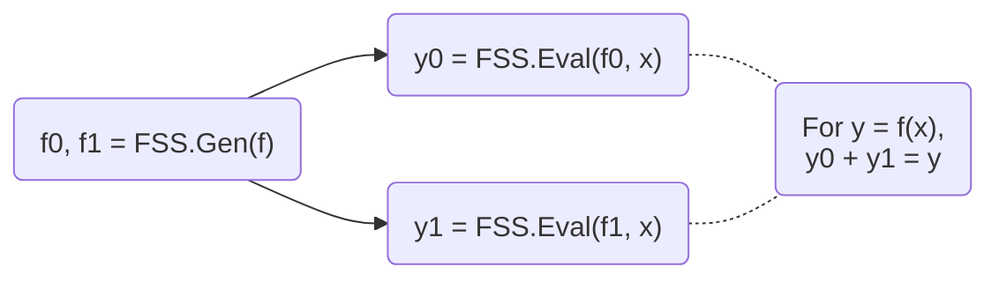
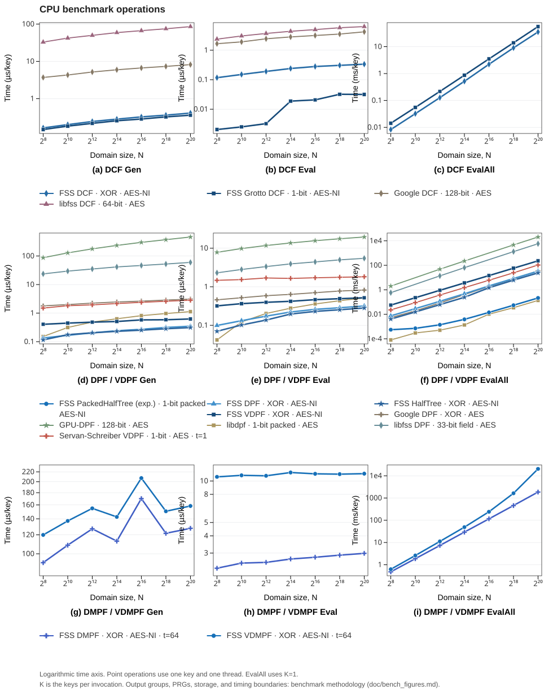
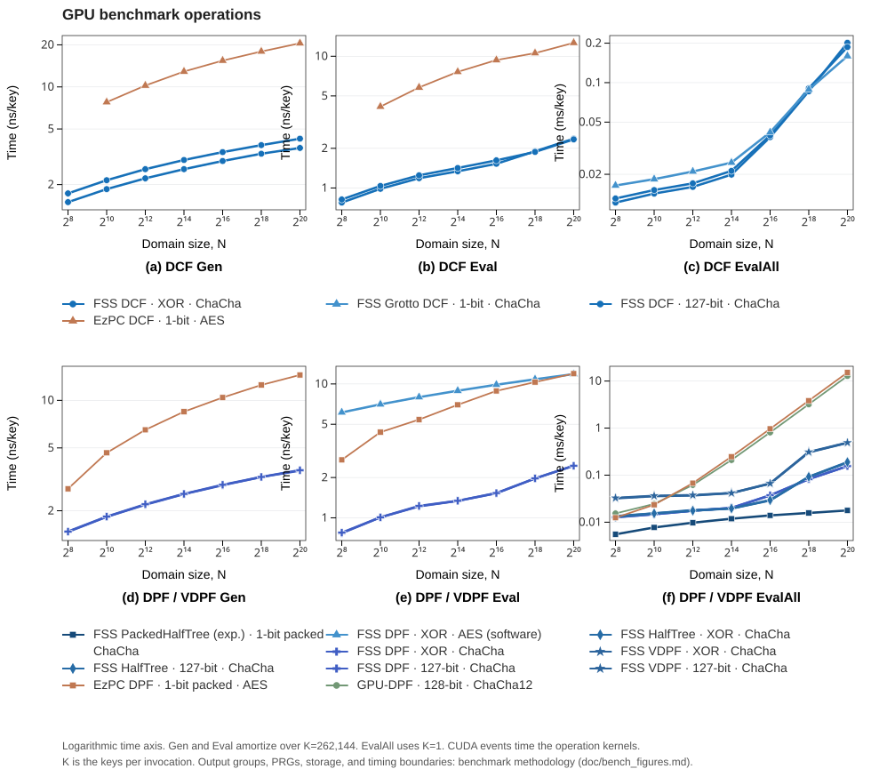

# myl7/fss

Function secret sharing (FSS) primitives including:

- 2-party distributed point function (DPF), based on [Boyle et al. (CCS '16)](https://doi.org/10.1145/2976749.2978429) or [Half-Tree (EUROCRYPT '23)](https://doi.org/10.1007/978-3-031-30545-0_12).
- 2-party distributed comparison function (DCF), based on [Boyle et al. (EUROCRYPT '21)](https://doi.org/10.1007/978-3-030-77886-6_30) or [Grotto (CCS '23)](https://doi.org/10.1145/3576915.3623147).
- 2-party verifiable distributed point function (VDPF), based on [Castro & Polychroniadou (EUROCRYPT '22)](https://doi.org/10.1007/978-3-031-06944-4_6).
- 2-party verifiable distributed multi-point function (VDMPF), based on [Castro & Polychroniadou (EUROCRYPT '22)](https://doi.org/10.1007/978-3-031-06944-4_6).
- 2-party distributed multi-point function (DMPF), the non-verifiable counterpart of VDMPF.

[Documentation](https://myl7.github.io/fss/)

Features:

- First-class support for GPU (based on CUDA)
- Top-tier performance shown by benchmarks
- Well-commented and documented
- Header-only library, easy for integration

## Introduction

**Multi-party computation (MPC)** is a subfield of cryptography that aims to enable a group of parties (e.g., servers) to jointly compute a function over their inputs while keeping the inputs private.

**Secret sharing** is a method that distributes a secret among a group of parties, such that no individual party holds any information about the secret.
For example, a number $x$ can be secret-shared into $x_0, x_1$ via $x = x_0 + x_1$.

**FSS** is a scheme to secret-share a function into a group of function shares.
Each function share, called as a **key**, can be individually evaluated on a party.
The outputs of the keys are the shares of the original function output.
FSS consists of 2 methods: `Gen` for generating function shares as keys and `Eval` for evaluating a key to get an output share.
FSS's workflow is shown below:



**DPF/DCF** are FSS for point/comparison functions.
They are called out because 2-party DPF/DCF can have $O(\log N)$ key size, where $N$ is the input domain size.
Meanwhile, 3-or-more-party DPF/DCF and general FSS have $O(\sqrt{N})$ key size.
More details, including the definitions and the implementation details that users must care about, can be found in the documentation of dpf.cuh and dcf.cuh files.

## Get Started

### Prerequisites

- CMake >= 3.22
- CUDA toolkit >= 12.0 (for C++20 support). C++ CI is configured for CUDA 12.6 and 13.4.
- OpenSSL 3 (only required for CPU with AES-128 MMO PRG)

### Build

Clone the repository:

```bash
git clone https://github.com/myl7/fss.git
cd fss
```

**Option A: Install via CMake and use `find_package`**

```bash
cmake -B build -DBUILD_TESTING=OFF -DCMAKE_INSTALL_PREFIX=/path/to/install
cmake --build build
cmake --install build
```

Then in your project's `CMakeLists.txt`:

```cmake
find_package(fss REQUIRED)
target_link_libraries(your_target fss::fss)
```

When configuring your project, point CMake to the install prefix:

```bash
cmake -B build -DCMAKE_PREFIX_PATH=/path/to/install
```

**Option B: Use as a subdirectory (header-only)**

Without installing, you can define the target directly in your `CMakeLists.txt`, like the samples do:

```cmake
add_library(fss INTERFACE)
target_include_directories(fss INTERFACE "/path/to/fss/include")
target_compile_features(fss INTERFACE cxx_std_20 cuda_std_20)
```

Then link it in your project:

```cmake
target_link_libraries(your_target fss)
```

### CPU

This walks through using DPF and DCF on the CPU with AES-128 MMO PRG.
This PRG requires OpenSSL.

1. Include the headers and set up type aliases:

   ```cpp
   #include <fss/dpf.cuh>
   #include <fss/dcf.cuh>
   #include <fss/group/bytes.cuh>
   #include <fss/prg/aes128_mmo.cuh>

   constexpr int kInBits = 8;  // Input domain: 2^8 = 256 values
   using In = uint8_t;
   using Group = fss::group::Bytes;

   // DPF uses mul=2, DCF uses mul=4
   using DpfPrg = fss::prg::Aes128Mmo<2>;
   using DcfPrg = fss::prg::Aes128Mmo<4>;
   using Dpf = fss::Dpf<kInBits, Group, DpfPrg, In>;
   using Dcf = fss::Dcf<kInBits, Group, DcfPrg, In>;
   ```

2. Create the PRG with AES keys and instantiate DPF/DCF:

   ```cpp
   // DPF PRG needs 2 AES keys
   unsigned char key0[16] = {1, 2, 3, 4, 5, 6, 7, 8, 9, 10, 11, 12, 13, 14, 15, 16};
   unsigned char key1[16] = {16, 15, 14, 13, 12, 11, 10, 9, 8, 7, 6, 5, 4, 3, 2, 1};
   const unsigned char *keys[2] = {key0, key1};
   auto ctxs = DpfPrg::CreateCtxs(keys);

   DpfPrg prg(ctxs);
   Dpf dpf{prg};
   ```

3. Run `Gen` to generate correction words (keys) from secret inputs:

   ```cpp
   In alpha = 42;                  // Secret point / threshold
   int4 beta = {7, 0, 0, 0};      // Secret payload (LSB of .w must be 0)

   // Random seeds for the two parties (LSB of .w must be 0)
   int4 seeds[2] = {
       {0x11111111, 0x22222222, 0x33333333, 0x44444440},
       {0x55555555, 0x66666666, 0x77777777, static_cast<int>(0x88888880u)},
   };

   Dpf::Key k0, k1;
   dpf.Gen(k0, k1, cuda::std::span<const int4, 2>(seeds, 2), alpha, beta);
   ```

4. Run `Eval` on each party and reconstruct using the group:

   ```cpp
   // Each party evaluates independently with its own key
   int4 y0 = dpf.Eval(false, k0, alpha);
   int4 y1 = dpf.Eval(true, k1, alpha);

   // Reconstruct via the group: convert to group elements, add, convert back
   // For Bytes group this is XOR; for Uint group this is arithmetic addition
   int4 sum = (Group::From(y0) + Group::From(y1)).Into();
   // sum == beta at x == alpha, 0 otherwise
   ```

5. Free the AES contexts when done:

   ```cpp
   DpfPrg::FreeCtxs(ctxs);
   ```

DCF follows the same pattern — use `DcfPrg` (mul=4, needs 4 AES keys) and `Dcf`; `Gen` fills one `Key` per party.
The reconstructed output equals `beta` when `x < alpha` and `0` otherwise.

Link with OpenSSL in your `CMakeLists.txt`:

```cmake
find_package(OpenSSL REQUIRED)
target_link_libraries(your_target fss OpenSSL::Crypto)
```

See `samples/dpf_dcf_cpu.cu` for the complete working example.

### GPU

This walks through using DPF and DCF on the GPU with ChaCha PRG.

1. Include the headers and set up type aliases:

   ```cpp
   #include <fss/dpf.cuh>
   #include <fss/dcf.cuh>
   #include <fss/group/bytes.cuh>
   #include <fss/prg/chacha.cuh>

   constexpr int kInBits = 8;
   using In = uint8_t;
   using Group = fss::group::Bytes;

   // DPF uses mul=2, DCF uses mul=4
   using DpfPrg = fss::prg::ChaCha<2>;
   using DcfPrg = fss::prg::ChaCha<4>;
   using Dpf = fss::Dpf<kInBits, Group, DpfPrg, In>;
   using Dcf = fss::Dcf<kInBits, Group, DcfPrg, In>;
   ```

2. Write a `Gen` kernel; the PRG stores its nonce by value, so one PRG instance works on host and device:

   ```cpp
   __global__ void GenKernel(Dpf::Key *keys0, Dpf::Key *keys1, const int4 *seeds, const In *alphas,
       const int4 *betas) {
       int tid = blockIdx.x * blockDim.x + threadIdx.x;

       DpfPrg prg(0x12345678, 0x9abcdef0);
       Dpf dpf{prg};

       int4 s[2] = {seeds[tid * 2], seeds[tid * 2 + 1]};
       dpf.Gen(keys0[tid], keys1[tid], cuda::std::span<const int4, 2>(s, 2), alphas[tid], betas[tid]);
   }
   ```

3. Prepare host data, copy to device, and launch the `Gen` kernel:

   ```cpp
   int4 *d_seeds = /* cudaMalloc + cudaMemcpy seeds to device */;
   In *d_alphas = /* cudaMalloc + cudaMemcpy alphas to device */;
   int4 *d_betas = /* cudaMalloc + cudaMemcpy betas to device */;

   Dpf::Key *d_k0s, *d_k1s;
   cudaMalloc(&d_k0s, sizeof(Dpf::Key) * N);
   cudaMalloc(&d_k1s, sizeof(Dpf::Key) * N);

   GenKernel<<<blocks, kThreadsPerBlock>>>(d_k0s, d_k1s, d_seeds, d_alphas, d_betas);
   ```

4. Write and launch an `Eval` kernel for each party, then copy results back:

   ```cpp
   __global__ void EvalKernel(int4 *ys, bool party, const Dpf::Key *keys, const In *xs) {
       int tid = blockIdx.x * blockDim.x + threadIdx.x;

       DpfPrg prg(0x12345678, 0x9abcdef0);
       Dpf dpf{prg};

       ys[tid] = dpf.Eval(party, keys[tid], xs[tid]);
   }

   // Launch for party 0 and party 1, then copy d_ys back to host
   EvalKernel<<<blocks, kThreadsPerBlock>>>(d_ys, false, d_k0s, d_xs);
   EvalKernel<<<blocks, kThreadsPerBlock>>>(d_ys, true, d_k1s, d_xs);
   ```

5. Reconstruct on the host using the group, same as the CPU case:

   ```cpp
   int4 sum = (Group::From(h_y0s[i]) + Group::From(h_y1s[i])).Into();
   ```

DCF follows the same pattern — use `DcfPrg` (mul=4) and `Dcf` with its own `Key`.

See `samples/dpf_dcf_gpu.cu` for the complete working example.

### Samples

`samples/` holds a standalone program per scheme.
They form their own CMake project:

```bash
cmake -B build/samples -S samples
cmake --build build/samples
```

| Sample                 | Scheme        | Shows                                                                |
| ---------------------- | ------------- | -------------------------------------------------------------------- |
| `dpf_dcf_cpu.cu`       | DPF, DCF      | Host `Gen`/`Eval` with AES-128 MMO PRG                               |
| `dpf_dcf_gpu.cu`       | DPF, DCF      | `Gen`/`Eval` inside CUDA kernels with ChaCha PRG                     |
| `half_tree_dpf_cpu.cu` | Half-Tree DPF | `Gen`/`Eval`/`EvalAll` with a mul=1 PRG and a separate hash key      |
| `packed_half_tree_dpf_cpu.cu` | Packed Half-Tree DPF (experimental) | Sub-128-bit packed outputs: `Gen`/`Eval`/`EvalAll`/`Extract` over packed blocks |
| `grotto_dcf_cpu.cu`    | Grotto DCF    | `Gen`/`Preprocess`/`Eval` over a parity segment tree, plus `EvalAll` |
| `vdpf_cpu.cu`          | VDPF          | `Gen`/`Eval`/`EvalAll` plus the `Prove`/`Verify` check               |
| `vdmpf_cpu.cu`         | VDMPF         | `Gen`/`BatchEval` over cuckoo-hash packed points                     |
| `dmpf_cpu.cu`          | DMPF          | `Gen`/`BatchEval` over cuckoo-hash packed points, without verification

The CPU samples link OpenSSL, and `EvalAll` uses OpenMP when it is found.

### Python

The `fss_crypto` package exposes PyTorch wrappers for every scheme: `Dpf`, `Dcf`, `HalfTreeDpf`, `PackedHalfTreeDpf`, `GrottoDcf`, `Vdpf`, `Dmpf`, and `Vdmpf`.
It is published on PyPI as `fss-crypto`.
`eval` and full-domain `eval_all` accept CUDA tensors (where the scheme has a GPU path); key generation stays on CPU.
The cuckoo-hashed multi-point schemes (`Dmpf`, `Vdmpf`) evaluate on CUDA when constructed with `prp="chacha_feistel"`; a VDMPF proof comes from the CPU sequential chains or the CUDA Merkle fold, so both parties must evaluate on the same device.

Install it with pip:

```bash
pip install fss-crypto
```

Or add it to a uv project:

```bash
uv add fss-crypto
```

The package requires Python >= 3.10 and PyTorch >= 2.6.
CI is configured for Python 3.10 with PyTorch 2.6 and CUDA 12.6, and Python 3.13 with PyTorch 2.13 and CUDA 13.4.
CI checks compilation and CPU execution.
GPU tests are skipped because CI runners have no GPU.
For JIT compilation, use a local CUDA toolkit with the same major version as `torch.version.cuda`.
The first use of each parameter set JIT-compiles a small CUDA extension with `torch.utils.cpp_extension.load`, so the CUDA toolkit is required even when the example below runs on CPU tensors.
The `aes128_mmo` PRG also links OpenSSL at JIT time.
Compiled extensions are cached under `~/.cache/fss_crypto`.

```python
import torch
import fss_crypto

dpf = fss_crypto.Dpf(in_bits=8, group="bytes", prg="chacha")

s0s = torch.tensor(
    [
        [0x11111111, 0x22222222, 0x33333333, 0x44444440],
        [0x55555555, 0x66666666, 0x77777777, -0x77777780],
    ],
    dtype=torch.int32,
)
beta = torch.tensor([7, 0, 0, 0], dtype=torch.int32)

cws = dpf.gen(s0s, alpha=42, beta=beta)
y0 = dpf.eval(party=0, s0=s0s[0], cws=cws, x=42)
y1 = dpf.eval(party=1, s0=s0s[1], cws=cws, x=42)

assert torch.bitwise_xor(y0, y1).equal(beta)
```

`gen` and `eval_all` are CPU-only.
`eval` can run on CUDA tensors for ChaCha PRG when CUDA is available.
The JIT path sets a default `TORCH_CUDA_ARCH_LIST` on machines with no visible GPU so CPU tests can still compile the extension.

To develop against a checkout instead, install the dev extra and run the tests:

```bash
uv sync --extra dev
uv run pytest
```

### Compiler Warnings

You may see warnings like "integer constant is so large that it is unsigned" during compilation.
These cannot be easily suppressed but are harmless and can be safely ignored.

### nvcc 12.8: `Uint` as a `__global__` kernel template argument

nvcc 12.8 fails to compile the stub file when `fss::group::Uint<__uint128_t, ...>` is used as a template argument to a `__global__` kernel — it emits a 128-bit integer literal that g++ cannot parse.
`__device__` functions are not affected (no stub is generated for them).

Workaround: wrap the type in a plain aggregate struct that satisfies `Groupable` but has no `__uint128_t` non-type template parameter in its name.
The struct must have no user-declared constructors to remain an aggregate.
See `third_party/fss/bench.cu` for an example.

## Benchmarks

See [benchmark methodology and comparison curves](doc/bench_figures.md) for the current full-output adapters and domain sweeps.
The binaries below are built on [Google Benchmark](https://github.com/google/benchmark) and time single operations.
The [benchmark coverage](doc/benchmarks.md) page lists what they measure and the GPU kernel register usage.

Configure with `BUILD_BENCH=ON` and build the targets:

```bash
cmake -B build -DBUILD_BENCH=ON -DCMAKE_BUILD_TYPE=RelWithDebInfo
cmake --build build --target bench_cpu bench_gpu
```

Run all benchmarks:

```bash
./build/bench_cpu
./build/bench_gpu
```

Run a subset using `--benchmark_filter` (regex):

```bash
./build/bench_cpu --benchmark_filter=BM_DcfGen
./build/bench_cpu --benchmark_filter=BM_DpfEval_Uint_Aes/20
```

The `Makefile` runs these sources through `third_party/bench.py`.
Both CPU and GPU runs pin the host process to `CPU_ID`, verify the performance governor, and restore its previous value on exit.
A governor change may require noninteractive `sudo`.
`make bench_gpu` also selects `GPU_ID`.
Builds, raw measurements, environment metadata, and reports are saved under `build/third_party/`.

```bash
CPU_ID=0 make bench_cpu
GPU_ID=1 CUDA_ARCH=86 make bench_gpu
```

The [third-party comparison guide](doc/bench_third_parties.md#running) covers fixed dependency versions, selecting libraries, and generating reports.
The `main` selection runs the benchmarks in this README:

```bash
python3 third_party/bench.py run --libraries main --platform cpu --cpu 24 \
  --repetitions 5 --min-time 1 --run-id readme-cpu
python3 third_party/bench.py run --libraries main --platform gpu --cpu 8 --gpu 1 \
  --cuda-arch 120 --repetitions 5 --min-time 1 --run-id readme-gpu
```

Choose idle, allowed CPU and GPU indices on your host.
Direct binary invocations above leave affinity and the governor to the caller.

`CUDA_ARCH` is only needed when CMake cannot infer the architecture.
Two more targets support the sections below: `make ptx_info` rebuilds with `--ptxas-options=-v` and collects the register usage into `build/ptx_info.log`, and `make profile_gpu` records an Nsight Systems profile of one benchmark selected by `GPU_PROFILE_BENCH`.

### Comparison Curves

The domain sweep measures domain sizes `N = 2^8, 2^10, ..., 2^20`.
Each figure is one platform, one scheme family per row — DCF (including Grotto DCF), DPF with its verifiable VDPF counterparts, and DMPF with VDMPF — and one operation per column: `Gen`, `Eval`, `EvalAll`.
Time axes are logarithmic and legends show each library's native output shape and PRG backend.
Hardware, sampling, timing boundaries, and reproduction commands are in the [curve methodology](doc/bench_figures.md).
The exact measured medians behind the curves, with per-domain values and pairwise library comparison, are on the [benchmark comparison site](https://myl7.github.io/fss/bench/).
An implementation appears in a panel only where it provides that method on that platform.



CPU point operations use one key and one thread, in µs/key.
`EvalAll` produces all N outputs for one key, in ms/key.
The slow materialized point-loop cases use five domain sizes.
The verifiable VDPF curves (FSS VDPF and the Servan-Schreiber reference, eprint 2021/580, single point) include proof generation in the timed evaluation.
Verification stays outside timing.
Grotto DCF point `Eval` times the parity-tree query with Preprocess outside timing.
DMPF and VDMPF use `t = 64` points over `m = 112` Cuckoo buckets.
VDMPF `EvalAll` materializes through BatchEval including proof generation.



GPU `Gen` and point `Eval` report time amortized per key, in ns/key.
`EvalAll` uses one key, in ms/key.
The native GPU-DPF and packed EzPC adapters keep their native output configurations.
GPU `EvalAll` covers DPF, HalfTree DPF, DCF, the one-bit packed HalfTree DPF, VDPF with the Merkle-fold proof computed on device, and Grotto DCF.
The threads-per-block sweep lives in the [curve methodology](doc/bench_figures.md#gpu-block-size-sensitivity).

### Flamegraph

Generate a CPU flamegraph with `perf` and [FlameGraph](https://github.com/brendangregg/FlameGraph):

```bash
perf record -g ./build/bench_cpu --benchmark_filter=BM_DpfEval_Uint_Aes/20
perf script | /path/to/FlameGraph/stackcollapse-perf.pl | /path/to/FlameGraph/flamegraph.pl > build/flamegraph.svg
```

`make flamegraph` runs the same steps, taking the FlameGraph checkout from `FLAMEGRAPH_DIR` (default `../FlameGraph`) and the benchmark from `FLAMEGRAPH_BENCH`:

```bash
FLAMEGRAPH_DIR=/path/to/FlameGraph FLAMEGRAPH_BENCH=BM_DcfGen_Uint_Aes/20 make flamegraph
```

Open `build/flamegraph.svg` in a browser.
The graph is interactive: click a frame to zoom in.

## License

Apache License, Version 2.0

Copyright (C) 2026 Yulong Ming <i@myl7.org>
