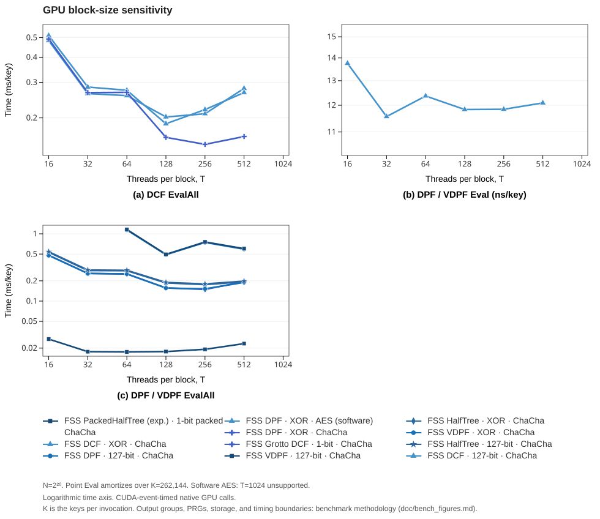

# Benchmark curve methodology

Use `third_party/figure_bench.py` to reproduce the time curves. Run from the
repository root on Linux after following the
[pinned dependency and toolchain setup](bench_third_parties.md).
CPU curves use `cs659b`: AMD EPYC 9115, NVIDIA RTX PRO 5000, SM 120, and
CUDA 13.2. The experiment pins CPU operations to CPU 24, uses one CPU
thread, and verifies the `performance` governor.
GPU curves use `cs11369a`: Intel Xeon Platinum 8352V, NVIDIA A6000, SM 86,
and CUDA 12.6. GPU runs pin the launch process to CPU 100, leaving the shared
host's CPU governor unchanged. The v1.3 repair recollection on 2026-10-18
uses GPU 3 for all current-FSS GPU domain and block curves. Retained
third-party receipts identify their original device and run configuration.
All four devices on this host are the same A6000 model.
Historical FSS 0.7 has no GPU curves: its upstream benchmarks crash on the
A6000 with a misaligned address, so the merge drops its GPU rows instead of
keeping measurements from the previous GPU.
The run manifest records the actual hardware, toolchain versions, affinity
arguments, and governor.

## Work and timing

The domain sweep uses `N = 2^n`, with
`n = 8, 10, 12, 14, 16, 18, 20`. CPU libfss and GPU-DPF materialized point-loop
EvalAll cases use `n = 8, 12, 14, 18, 20` because each iteration calls point
Eval at all N inputs. The other supported cases use seven domain sizes.
The separate current-FSS block sweep fixes `n = 20` and uses
`T = 16, 32, 64, 128, 256, 512, 1024` threads per block.

CPU Gen measures one two-party key generation. CPU Eval measures one
party at one query. EvalAll measures one party over N logical domain outputs
with one key. Ordinary GPU Gen and point Eval use 262144 independent keys
per invocation. GPU DMPF/VDMPF Eval uses one key and 262144 queries. Their
key count is 1, their query count is 262144, and their point time is ns/query.
Full-domain GPU evaluation uses one key. Domain runs request T=256 for point
operations and T=128 for full evaluation where configurable. EzPC and the
multi-point kernels use fixed T=256. A packed frontier may use fewer threads
than requested for a small domain.

The collector checks native domain, launch, and explicit work-count counters
against the requested case before accepting a receipt. The supported-case
registry controls both default and scoped GPU filters. Only the DPF software-AES
point workload is in the block sweep. A scoped block sweep for a different
scheme skips point Eval instead of selecting that DPF workload.

Records preserve raw elapsed `median_ns` and `time_ns`. The explicit fields
`key_count`, `query_count`, and `domain_output_count` state the work per timed
invocation. Gen, Prepare, and EvalAll use `time_denominator="key"`. Eval uses
`time_denominator="query"`. `ns_per_unit` divides raw elapsed time by that
count. `ns_per_domain_output` divides full-domain elapsed time by the logical
output count, including when outputs are packed. These rates do not count
packed storage words as domain outputs. `workload` distinguishes independent
keys from a single-key query batch. `setup_included` and `timing_boundary`
state what the timed operation contains.

`num_keys` and `ns_per_key` remain historical export fields. Their original
values are also recorded in `legacy_quantity_fields`. They mislabeled old
multi-query batches and must not be used for new normalization. Receipt
counters take priority over requested T, which is retained as
`requested_threads_per_block`. For old multi-point receipts without counters,
the collector recognizes the verified wrappers at e25a42c and 84b93e5 by
SHA-256. They establish one key, kN queries, and fixed T=256 without changing
the elapsed measurements. Unknown wrapper/counter combinations are marked
`metadata_status="requires_recollection"` and omitted from figures. This
metadata repair does not represent a new measurement.

The mastic, plasma, dpf-cpp, and dpfplusplus additions join the CPU sweep with
their own availability windows. mastic covers Gen at n = 12, 16, 20, Eval at
n = 16, and EvalAll at n = 12, 16, 20; its EvalAll rows time both parties'
`eval_tree` including the BLAKE3 proof digest comparison, and its outputs are
Field128 shares. plasma covers Gen at n = 16, 20 and Eval at n = 16 with the
running proof chained into the timing; upstream has no full-domain API.
dpf-cpp and dpfplusplus cover Gen and Eval at n = 16, 20 and EvalAll at
n = 16, 18, 20 with bit-valued outputs (a packed-bit truth table and 128-lane
packed nodes respectively); dpf-cpp's Gen draws from a fixed-seed test PRG.
sycret does not join the domain sweeps: its EQ and CMP batched operations are
reported by `bench.py` only, counted per key or point over its fixed 32-bit
domain. dpfplusplus sources are fetched and patched at bench time because the
upstream license forbids redistribution
([bench-dpfplusplus.md](bench-dpfplusplus.md)).

Current-FSS specialty schemes extend these boundaries. Grotto DCF point Eval
times the parity-tree query only, with Preprocess outside timing, and its
EvalAll times Preprocess plus the scan as one full-domain operation.
DMPF and VDMPF use `t = 64` points with `m = ChBucket(64, 80) = 112` Cuckoo
buckets and bucket domains of `2^(n-5)`. DMPF EvalAll evaluates every padded
bucket domain, and VDMPF EvalAll materializes through BatchEval over all N
inputs, including proof generation, as a point loop.
On the GPU, DMPF Eval evaluates a `2^18`-point batch per launch through the
one-thread-per-point kernel, and EvalAll full-domain-evaluates every bucket
key before gathering each domain point's Cuckoo buckets.
GPU VDMPF Eval and EvalAll run the same batch pipeline with the Merkle-fold
proof included in the timing, while the CPU VDMPF curves time the
paper-faithful sequential chains - the accumulator difference follows the
per-platform-implementation split below, and proofs do not verify across the
two accumulators.
CPU VDPF point Eval times `Eval` plus `Prove` on the one-element proof
sequence. Both CPU Eval and the default EvalAll therefore carry a chain
accumulator label. Gen generates key material and has no timed proof
accumulator. The metadata records `proof_accumulator` and
`proof_generation_included` independently of the preserved raw names.
The CPU VDPF `Merkle/EvalAll` row joins the plain chain row with the other
accumulator choice: its timed loop produces the Merkle-fold proof, and
verification runs outside timing with the accumulator required to match
between the two parties
([the security doc](vdpf_merkle_fold_security.md)).
VDMPF and VDPF variants carry the accumulator in their names, `-chains` for
the CPU chain rows and `-merkle-fold` or `-merkle` for the Merkle-fold rows,
so the legends and the comparison site keep the difference visible.
The two platforms drive the Cuckoo Locate with their own optimal PRP backend:
GPU curves use the device-callable `ChaChaFeistel` while CPU curves keep the
OpenSSL-backed `Aes128Feistel`, and the figures compare implementations within
one platform, never across. The CPU DMPF and VDMPF panels additionally carry
`AES-NI-rawprp` twins of all three operations — the same construction on the
intrinsics `Aes128FeistelRaw` backend — beside the OpenSSL-PRP rows. Packed HalfTree DPF
EvalAll emits `N/128` packed blocks for one-bit outputs. CPU benchmarks pin
one CPU, which also pins the OpenMP team to one thread. DMPF EvalAll would
otherwise pay one parallel-region spawn per bucket. The Servan-Schreiber VDPF
reference adapter follows upstream test usage: its MMO hash objects are
stateful (AES-CTR), so each timed Gen, Eval, or EvalAll re-initializes them
inside the timing region, and proof verification is an equality check
outside timing.

Plain DPF and HalfTree DPF add packed-key preparation and point evaluation
rows while their Eval curves stay the unprepared default. `PackedKey/Prepare`
times only packing one key and reports time/key with query_count=0. Key
generation and validation are outside timing. `PackedKey/Eval` packs the key once
outside timing and times only prepared-key point evaluations cycling over the
domain. `PackedKeyOneShot/Eval` times the pack plus one point evaluation per
iteration, which is the cost without key reuse. The timed loop prevents the
compiler from lifting preparation outside the iteration. Both rows check bit-exact
agreement with the scheme Eval for both parties outside timing.

Current FSS GPU FullEval sets `z = min(17, n)` for DPF,
`z = min(17, n - 1)` for HalfTreeDPF, and `b1 = z - log2(T)`.
The T sweep therefore adjusts the block root depth to satisfy the public
kernel constraint `2^(z - b1) = T`. The timed kernel includes all tree
traversal and excludes key generation, allocation, and upload.

Google Benchmark runs use five repetitions, at least 0.1 seconds of
measurement, and 0.1 seconds of warmup. The figure uses the median.
Rust cases use five separate Criterion processes, each with 20 samples,
0.2 seconds of warmup, and a 0.2-second requested measurement interval.
The figure uses the median of the five process medians. Criterion can extend
an interval for a slow operation. Setup and correctness checks outside the
measured iteration do not contribute to operation time.

CPU timings use framework wall time. Current FSS and historical FSS GPU
harnesses use CUDA events around operation kernel launches, with allocation
and input copies outside timing. EzPC Gen/Eval events surround the native GPU
API calls and include GPU work and transfers within that interval. EzPC full
evaluation times its packed output adapter kernel. GPU-DPF full evaluation
places events around the native `dpf_hybrid` call, with key upload and result
download outside timing. These boundaries appear in each record.

GPU-DPF full evaluation uses `FUSES_MATMUL=0`, one native block, and K=1. It
materializes uint128 outputs in native bit-reversed domain order. The checker
maps that order to input x outside timing. The EzPC full adapter writes packed
bits using the upstream DFS expansion, launches 256 threads, and has one
active DFS thread. Label these implementations and their timing boundaries
when comparing them with current FSS output materialization.

The renderer and comparison site obtain expected domain coordinates from all
measurement statuses and planned run cases. An omitted or failed coordinate
breaks each affected curve, including when the entire panel has no successful
measurement there. Table cells remain empty. No positive values are
interpolated to fill those gaps.

## Native configurations and validation

The primary current-FSS CPU curves use AES-NI and the byte group: 127 logical
output bits in 128-bit storage. Earlier tables used OpenSSL AES for current
FSS CPU operations. That PRG configuration differs, so the new figure values
can differ from those tables.

| Implementation | Native output configuration |
| --- | --- |
| Current FSS and historical FSS 0.7 | 127-bit XOR byte group, 128-bit storage · optional integer group modulo 2^127 |
| Current FSS Grotto DCF | One logical comparison bit · EvalAll returns N bool shares |
| Current FSS packed HalfTree DPF (experimental) | One logical bit · EvalAll returns N/128 packed 128-bit blocks |
| Current FSS VDPF EvalAll | Merkle-fold proof accumulated on device and on the CPU `Merkle` row · the base CPU VDPF EvalAll row keeps the paper's sequential chain · analysis in [the security doc](vdpf_merkle_fold_security.md) |
| Current FSS DMPF / VDMPF | 127-bit XOR byte group per point · t=64 points over m=112 Cuckoo buckets |
| Servan-Schreiber VDPF (reference) | One logical bit · uint128 shares materialized per point · single point (t=1) |
| Rust FSS 0.6 | 128-bit XOR bytes · optional integer group modulo 2^128 |
| Google DPF / DCF | XOR128 / additive integers modulo 2^128 |
| GPU-DPF CPU and GPU | uint128 scalar output |
| libdpf | One logical bit · Eval returns a packed 128-bit leaf, EvalAll returns N/128 leaves |
| libfss DPF / DCF | GMP scalar modulo nextprime(2^32), a 33-bit field / uint64 modulo 2^64 |
| EzPC full adapter | Packed binary output |

The packed HalfTree GPU wrapper uses `ChaCha<1>`. Its metadata therefore
records `ChaCha20-x1` and one output block. Earlier `x2` labels are corrected
from the wrapper without changing their elapsed measurements.

The legends and records retain native PRGs: current-FSS CPU AES-NI, its GPU
ChaCha variants and software-AES point variant, GPU-DPF GPU ChaCha12, EzPC
and Google AES128, and historical FSS CPU AES-MMO-NI and GPU Salsa12.
libdpf uses `AES128-MMO/RustCrypto`, with runtime AES-NI dispatch from the
pinned `aes 0.8.4` crate. libfss uses `AES128-MMO/OpenSSL` through the low-level
`AES_encrypt` API. The Servan-Schreiber VDPF reference uses OpenSSL EVP
AES-128 (ECB for the PRG expansion, CTR for the MMO hash). Output groups,
packing, PRGs,
and APIs differ across implementations. The experiment reports their native
operation times for the configurations listed in each record.

Current FSS GPU EvalAll uses the corrected shared-frontier barriers and depth
bounds from commit `5ce7740`. The checks cover both party shares and their
reconstruction outside timing. Google DCF uses supported additive uint128;
the earlier XOR adapter configuration failed reconstruction because the
native DCF zero-value conversion does not handle XOR wrappers. Rust FSS 0.6
additive DCF fails equal-alpha reconstruction and stays outside the primary
byte-group curves. Preserve that failure if collecting optional integer
variants with `--include-uint`. EzPC's strict DCF API rejects n=8. Historical
FSS 0.7 has no native full-domain API. Keep these statuses in the dataset.

The CPU and GPU overviews use five rows with Gen, Eval, and EvalAll columns:

| Row | Overview methods |
| --- | --- |
| DCF | Default FSS DCF, Grotto DCF, Google DCF, libfss DCF, and measured GPU references |
| DPF full width | Default FSS DPF, HalfTree, Google DPF, libfss DPF, and GPU-DPF |
| Packed DPF | FSS packed HalfTree, libdpf, and an ordinary FSS reference where a packed method was measured |
| VDPF | Default FSS VDPF and measured verifiable references |
| DMPF / VDMPF | Default DMPF and VDMPF with the same point count |

These absolute comparisons retain the slow baselines on log time axes.
CPU point operations use µs, GPU point operations use ns, and full-domain
operations use ms. The focused setup panels use ns/key. Eval is per query. The other columns are per key. A
single-key GPU batch and independent-key GPU point workload remain distinct
in the records and site configuration. The full grid leaves missing operations
absent, including GPU VDPF Gen/Eval and multi-point GPU Gen.

Prepared-key variants have a focused default-byte-group comparison with separate setup,
steady-state query, and pack-plus-query panels. A speedup panel is produced
only for actual paired direct/variant measurements with matching configuration
and source hashes. The pairing retains the direct reference receipt. It does
not derive standalone setup cost from unrelated medians. Integer-group
prepared variants remain selectable on the comparison site and are listed
in the method inventory.

The [prepared-key figure](figures/cpu-prepared.svg),
[proof-accumulator figure](figures/cpu-proof.svg),
[PRP-backend figure](figures/cpu-prp.svg), and
[GPU output-group and PRG figure](figures/gpu-output-groups.svg) retain
specialized comparisons. The [comparison site](https://myl7.github.io/fss/bench/)
retains all measured variants, including historical FSS versions and additional
native libraries. `build/figures/manifest.json` inventories each measured
method's static figure and site locations. Supplementary figures are generated
only when the required data exist.

The shared description model names direct queries, prepared queries,
pack-plus-query operations, standalone preparation, chain/Merkle proofs,
OpenSSL/raw PRPs, native output widths/groups, and point counts. Colors identify
constructs and dash/marker combinations identify variants. The pipeline checks
unique labels and complete styles inside each panel and shared row legend.
A shared construction style has one legend entry with operation-specific
configuration, such as Gen/Eval output versus packed EvalAll output, or VDPF key generation versus chain point/full-domain proofs. This presentation does
not merge measurement records or their sources. Lines do not shift or
interpolate missing domain sizes. A broken y axis is not used because the slow
and fast curves occupy overlapping time ranges as N changes.

## GPU block-size sensitivity



The supplementary block sweep fixes `N = 2^20` and varies actual threads per
block T: point `Eval` (including software AES) amortized over `K = 262,144`
keys, and full-domain `EvalAll` with `K = 1` for the DCF, DPF, HalfTreeDPF,
packed, VDPF, and Grotto schemes. Fixed-256-thread DMPF/VDMPF kernels are
excluded from this sensitivity sweep. The sweep adjusts the block
root depth as described above. VDPF has no T=16 and T=32 points because no
tiling satisfies its root-fold constraints at those block sizes, and
software AES at T=1024 exceeds the kernel's
resource limit and has no timing point. The README keeps the domain-size
comparison figures. This figure stays in the methodology documentation.

## Run and export

Inspect the requested cases before starting. Each `run` directory must be
new. Use a new suffix for a repeated experiment. The examples use the defaults
of five repetitions and the measurement settings above.

```sh
python3 third_party/figure_bench.py list --platform cpu --sweep domain
python3 third_party/figure_bench.py run --platform cpu --sweep domain \
  --cpu 24 --cpu-prg aes-ni --governor performance --jobs 2 \
  --directory build/third_party/sweep/results/cpu-domain
python3 third_party/figure_bench.py run --platform gpu --sweep domain \
  --cpu 100 --gpu 1 --cuda-arch 86 --governor keep --jobs 2 \
  --directory build/third_party/sweep/results/gpu-domain
python3 third_party/figure_bench.py run --platform gpu --libraries fss \
  --sweep block --operations Eval EvalAll --domain-bits 20 \
  --threads-per-block 16 32 64 128 256 512 1024 \
  --num-keys 262144 --cpu 100 --gpu 1 --cuda-arch 86 \
  --governor keep --jobs 2 \
  --directory build/third_party/sweep/results/gpu-block
python3 third_party/figure_bench.py export \
  --directory build/third_party/sweep/results/cpu-domain
python3 third_party/figure_bench.py merge \
  --inputs build/third_party/sweep/results/cpu-domain \
    build/third_party/sweep/results/gpu-domain \
    build/third_party/sweep/results/gpu-block \
  --directory build/third_party/sweep/results/merged
```

`run` exports its `chart-data.json` and CSV. The default GPU Eval collection
uses the same supported-case registry as `--scheme`, and includes DMPF and
VDMPF. Explicit scheme selection skips unsupported operations. Prepare rows
are collected alongside the ordinary CPU Eval sweep, keeping the CLI's three
ordinary operation defaults unchanged. The current published curves merge
the `figure-data-r5` baseline and the cs11369a DMPF / VDMPF cards with eight
cs659b re-measurement runs on the integrated revision: the pipelined
full-domain rows at n = 8, 10, and 16, the n = 10 DMPF / VDMPF / VDPF rows,
the DPF and Half-Tree point-evaluation sweep with its packed-key rows, and the
VDPF chain and Merkle-fold rows, each superseding the cells it re-measured
through `merge --retry-inputs`. A second round of three runs covers the CPU
scheme round: the VDMPF chain rows after the quadratic dedup scan fix, the DCF
rows after the frontier pipelining, and the DMPF rows together with their
`AES-NI-rawprp` PRP twins (the VDMPF twins were collected with the same run),
each superseding its predecessors. Use `export` on an individual
run to rebuild them from saved `case.json` files. `merge` combines completed
run exports. For an explicit retry, pass its directory to `merge --retry-inputs`
and retain the superseded attempt provenance. A nonzero exit status can
accompany a completed dataset containing recorded failures. Inspect the
records and logs before continuing.

Build caches live under `build/third_party/sweep/<library>/<platform>`.
Each result directory contains the run manifest, source, lockfile, and raw-result hashes,
per-case configuration and statuses, exact commands, logs, and native JSON or
Criterion estimates. Keep these files with the merged data.

Use the offline D3/Playwright setup in
[the figure authoring guide](https://github.com/myl7/fss/blob/main/doc/figures/authoring/README.md), then export and inspect
`build/figures` before publishing. Install D3 under `build/figure-tools` and
configure the local Playwright runtime through `FSS_FIGURE_NODE_MODULES` when
the exporter's default runtime path is unavailable. Keep browser downloads
under `build/figure-tools/browsers` as described in that guide:

```sh
node doc/figures/authoring/export.mjs \
  build/third_party/sweep/results/merged/chart-data.json
node doc/figures/authoring/export.mjs \
  build/third_party/sweep/results/merged/chart-data.json --publish
```

The exporter writes authoring HTML, SVG, 2x PNG, and a source manifest under
`build/figures`. `--publish` copies the reviewed SVG and PNG assets to
`doc/figures`, removes previously published figures that the export no longer
produces, and writes `doc/site/data.json`: the trimmed domain-sweep dataset
behind the [comparison site](https://myl7.github.io/fss/bench/) in `doc/site`.
The site is static and dependency-free. Preview it locally with
`python3 -m http.server -d doc/site`.
