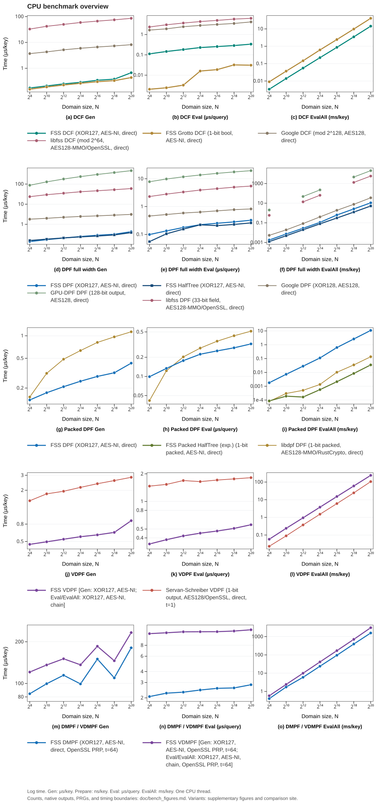
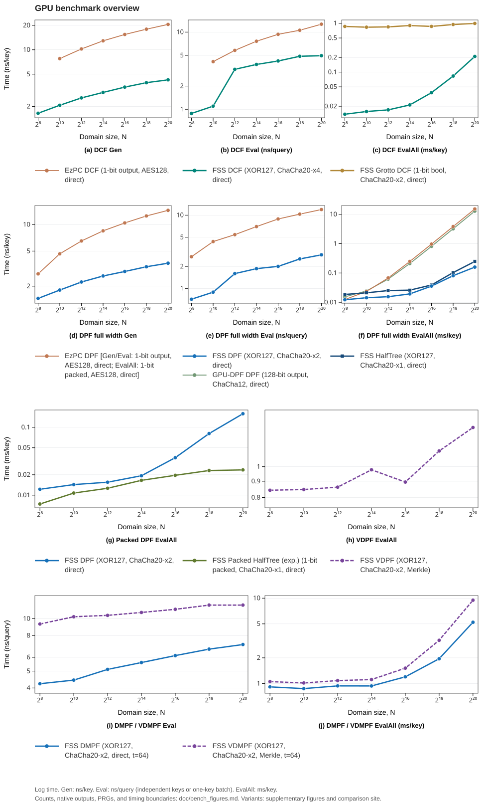

# Run benchmarks and profiles

See [benchmark methodology and comparison curves](bench_figures.md) for the full-output adapters and domain sweeps.
The binaries below use [Google Benchmark](https://github.com/google/benchmark).
Each row times its named operation; batch and full-domain operations process multiple outputs per iteration.
The [benchmark coverage](benchmarks.md) page lists what they measure and the GPU kernel register usage.

Configure with `BUILD_BENCH=ON` and build the targets:

```bash
cmake -B build -DBUILD_BENCH=ON -DCMAKE_BUILD_TYPE=RelWithDebInfo
cmake --build build --target bench_cpu bench_gpu
```

Run all benchmarks:

```bash
./build/bench_cpu
./build/bench_gpu
```

Run a subset using `--benchmark_filter` (regex):

```bash
./build/bench_cpu --benchmark_filter=BM_DcfGen
./build/bench_cpu --benchmark_filter=BM_DpfEval_Uint_Aes/20
```

The `Makefile` runs these sources through `third_party/bench.py`.
Both CPU and GPU runs pin the host process to `CPU_ID`, verify the performance governor, and restore its previous value on exit.
A governor change may require noninteractive `sudo`.
`make bench_gpu` also selects `GPU_ID`.
Builds, raw measurements, environment metadata, and reports are saved under `build/third_party/`.

```bash
CPU_ID=0 make bench_cpu
GPU_ID=1 CUDA_ARCH=86 make bench_gpu
```

Both targets use the `decision` profile by default; override them with `BENCH_PROFILE` and `BENCH_WORKLOAD`, e.g. `make bench_gpu BENCH_PROFILE=publication BENCH_WORKLOAD=legacy` reproduces the historical workload and sampling.

## Run profiles

Both Python runners resolve a shared profile through `third_party/benchmark_policy.py`.
Explicit `--min-time` and `--repetitions` values (and `--warmup` on the figure runner) always override the profile timing, and explicit selection arguments always override the profile selection.

| Profile | Timing defaults | Selection defaults |
| --- | --- | --- |
| `decision` (default) | 0.3 s minimum measurement, one repetition, no extra warmup | current library only: `--libraries main` for `bench.py`; the FSS wrapper at `n = 8, 20` on the figure runner |
| `smoke` | 0.01 s, one repetition | current library, full-domain rows included |
| `publication` | `bench.py`: 1 s and five repetitions; figure runner: 0.1 s measurement, 0.1 s warmup, five repetitions | each runner's historical default selection |

`--smoke` remains an alias for `--profile smoke`; combining it with a different explicit profile fails.
The `decision` default excludes the internal compact-path and point-launcher experiment rows (names containing `EvalPoint`) from the `main` library; an explicit `--filter` and the `publication` profile keep the full selection.
Smoke includes the full-domain rows instead of excluding them, so one correctness run covers at least one real `n = 20` full evaluation.

`--plan` prints the resolved libraries, exact filters, timing budget, and work configuration without building or touching hardware.
The native result-row count is printed as unresolved because it is known only after the run.

### Full-domain launch control

The main GPU batch full-domain rows process the `2^20`-key fixture through saturated 1024-key API calls.
`--workload daily` (default) runs one full API call per iteration, `--workload legacy` restores the historical 1024 calls per iteration, and `--full-launches N` selects 1 to 1024 calls explicitly.
The runner forwards the resolved value through `FSS_BENCH_FULL_LAUNCHES` and records it in the run manifest and `--plan`; the executed `calls_per_iteration` and `batch_keys` counters are checked against that plan, and batch keys stay 1024.
`--workload legacy` conflicts with an explicit `--full-launches` other than 1024.
The daily row keeps real batch throughput semantics with a workload identity different from the legacy row, and its 1024-key batch cost divided by 1024 is an amortized per-key cost, not single-key latency.

New main and FSS receipts carry per-iteration work counters with `work_schema_version = 1`.
The runner normalizes them as time per iteration divided by work per iteration, keeps logical output counts, packed output bytes, and GPU host wall time in separate summary columns, and records the process wall time per command separately.
`output_bytes` counts logical output storage bytes, not DRAM traffic.
Rows without the schema marker, including historical receipts and unchanged third-party adapters, keep the legacy name-based reading and are marked `legacy` in the summary.

Reproduce the historical workload and sampling together with `--profile publication --workload legacy`.

The [third-party comparison guide](bench_third_parties.md) covers fixed dependency versions, selecting libraries, and generating reports.
The `main` selection runs this library's benchmarks; the explicit sampling options below override the `decision` timing defaults:

```bash
python3 third_party/bench.py run --libraries main --platform cpu --cpu 24 \
  --repetitions 5 --min-time 1 --run-id readme-cpu
python3 third_party/bench.py run --libraries main --platform gpu --cpu 8 --gpu 1 \
  --cuda-arch 120 --repetitions 5 --min-time 1 --run-id readme-gpu
```

Choose idle, allowed CPU and GPU indices on your host.
Direct binary invocations above leave affinity and the governor to the caller.

`CUDA_ARCH` is only needed when CMake cannot infer the architecture.
Two more targets support the sections below: `make ptx_info` rebuilds with `--ptxas-options=-v` and collects the register usage into `build/ptx_info.log`, and `make profile_gpu` records an Nsight Systems profile of one benchmark selected by `GPU_PROFILE_BENCH`.

## Comparison Curves

The domain sweep measures domain sizes `N = 2^8, 2^10, ..., 2^20`.
Each figure shows one platform, with five rows: DCF, full-width DPF, packed DPF, VDPF, and DMPF/VDMPF. Columns show `Gen`, `Eval`, and `EvalAll`.
Logarithmic time axes retain the full measured range. Legends distinguish the construction, output shape, PRG, and proof accumulator; colors, markers, and line styles identify each method.
Separate figures cover [prepared-key costs](figures/cpu-prepared.svg), [proof accumulators](figures/cpu-proof.svg), [PRP backends](figures/cpu-prp.svg), and [output groups](figures/cpu-output-groups.svg). The comparison site supports selecting individual methods to inspect overlapping curves.
Hardware, sampling, timing boundaries, and reproduction commands are in the [curve methodology](bench_figures.md).
The exact measured medians behind the curves, with per-domain values and pairwise library comparison, are on the [benchmark comparison site](https://myl7.github.io/fss/bench/).
An implementation appears in a panel only where it provides that method on that platform.
Gen timings count one call producing both party keys.



CPU point evaluation uses one key and one thread, in µs/query; generation uses µs/key.
`EvalAll` produces all N outputs for one key, in ms/key.
The slow materialized point-loop cases use five domain sizes.
The verifiable VDPF curves (FSS VDPF and the Servan-Schreiber reference, eprint 2021/580, single point) include proof generation in the timed evaluation.
Verification stays outside timing.
Grotto DCF point `Eval` times the parity-tree query with Preprocess outside timing.
DMPF and VDMPF use `t = 64` points over `m = 112` Cuckoo buckets.
The VDMPF `EvalAll` benchmark materializes all inputs through batch evaluation, including proof generation.



GPU `Gen` reports ns/key. Point `Eval` reports ns/query: ordinary point kernels use independent keys, while DMPF/VDMPF evaluate many queries against one key.
`EvalAll` uses one key, in ms/key.
The native GPU-DPF and packed EzPC adapters keep their native output configurations.
GPU `EvalAll` covers DPF, HalfTree DPF, DCF, the one-bit packed HalfTree DPF, VDPF and VDMPF with Merkle-fold proofs computed on device, Grotto DCF, and DMPF.
The threads-per-block sweep lives in the [curve methodology](bench_figures.md).

## Flamegraph

Generate a CPU flamegraph with `perf` and [FlameGraph](https://github.com/brendangregg/FlameGraph):

```bash
perf record -g ./build/bench_cpu --benchmark_filter=BM_DpfEval_Uint_Aes/20
perf script | /path/to/FlameGraph/stackcollapse-perf.pl | /path/to/FlameGraph/flamegraph.pl > build/flamegraph.svg
```

`make flamegraph` runs the same steps, taking the FlameGraph checkout from `FLAMEGRAPH_DIR` (default `../FlameGraph`) and the benchmark from `FLAMEGRAPH_BENCH`:

```bash
FLAMEGRAPH_DIR=/path/to/FlameGraph FLAMEGRAPH_BENCH=BM_DcfGen_Uint_Aes/20 make flamegraph
```

Open `build/flamegraph.svg` in a browser.
The graph is interactive: click a frame to zoom in.
